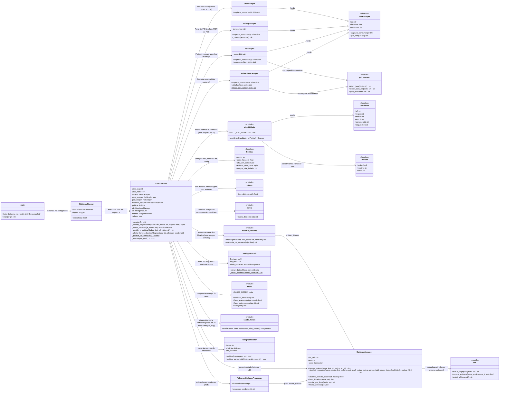

# Diagrama de Classes — Monitor de Concursos

> O agendamento é externo: Windows Task Scheduler (`scripts/install_schedule.ps1`) ou cron horário com catch-up + `@reboot` no Linux (`scripts/install_schedule.sh`). As regras da elegibilidade (as nove da tabela, com precedência) estão na SPEC-001, seção 4.2, e nas ADRs `docs/adr/0001` (a porta do MCP) e `docs/adr/0002` (o teto como evidência).
