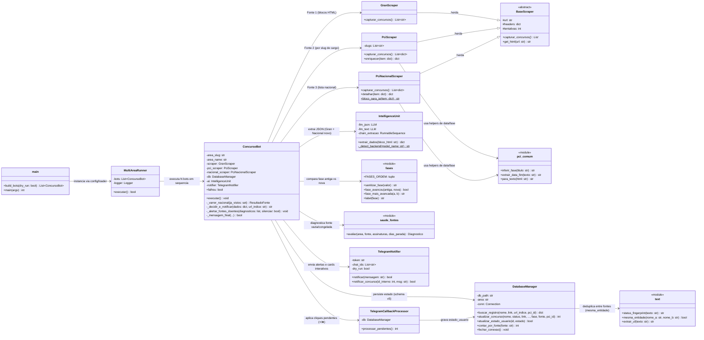

# Diagrama de Classes — Monitor de Concursos

> O agendamento é externo: Windows Task Scheduler (`scripts/install_schedule.ps1`) ou cron horário com catch-up + `@reboot` no Linux (`scripts/install_schedule.sh`).
