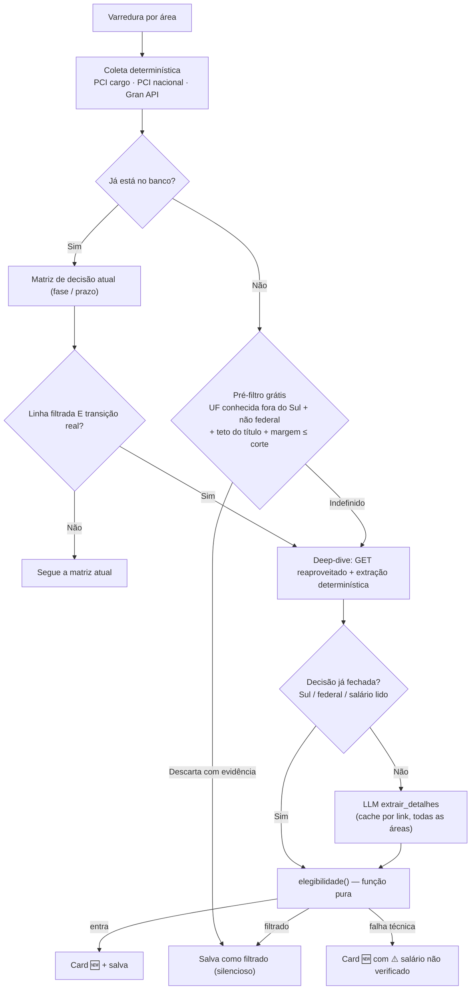

# Plano de Evolução — Monitor de Concursos (v2)

> [!IMPORTANT]
> **Ponto de partida:** `main` @ `1eb1a1f` (22/10/2026). A branch `feat/pci-como-segunda-fonte-e-catchup` já foi integrada: `PciScraper`, `PciNacionalScraper`, `saude_fontes`, `mesma_entidade`, schema v5 e **272 testes passando**. Cada fase abaixo sai numa branch própria a partir de `main`.

## 0. Revisão da v1 (21/10) → v2 (22/10)

A v1 acertou o diagnóstico e o instinto de "determinístico primeiro". Quatro coisas mudaram depois de conferir as premissas contra o código e as fontes reais:

1. **Gran não precisa de Playwright.** O blog é WordPress e expõe `/wp-json/wp/v2/posts` e `/feed/`, ambos estáticos, com data de modificação e categoria por UF. Isso resolve o artigo congelado (132 dias sem mudar em 22/10) sem browser headless.
2. **O agente de autocorreção de seletores foi para o backlog.** Nenhum incidente real do projeto foi seletor quebrado, e o `browser-use` não roda sobre o `claude -p` usado em produção. Detalhes na §7.
3. **As regras de elegibilidade viraram uma função única, com precedência explícita.** As seções 2, 3.1 e 4.1 da v1 se contradiziam sobre federais. A v1 também não dizia o que acontece quando a extração falha (agora *fail-open*), nem como um concurso filtrado volta a ser avaliado quando sai o edital.
4. **O pré-filtro grátis da listagem rende pouco, e agora o plano mostra quanto** (§1). O custo real está no deep-dive, que agora tem cache, orçamento por rodada e só chama a LLM quando a resposta muda a decisão.

---

## 1. Diagnóstico (medido em 22/10/2026)

1. **Salário de manchete e "Vários Cargos".** O título da listagem traz o teto do edital inteiro, que costuma ser de Médico ou Procurador, não da vaga de TI ou Educação. E nem sempre traz valor: no slug `analista-de-sistemas`, só **11 de 21** títulos têm `R$`.
2. **Ruído geográfico.** No slug `professor` o PCI lista **592** concursos: **302 no Sul** (SC 182, RS 104, PR 16) e **290 fora**. Desses 290, só **69** trazem `R$` no título, **24** têm teto ≤ R$ 5.000 e **1** tem teto ≤ R$ 3.000.
   - Consequência 1: como o Sul entra sempre, o filtro salarial só atua sobre metade do volume da Educação.
   - Consequência 2: com margem honesta para benefícios (teto + R$ 2.000 ≤ corte), o pré-filtro da listagem descarta **1 de 290**. Quase toda a decisão depende de abrir a notícia.
3. **Gran parado.** `concursos-ti/` continua com `dateModified` 12/06/2026. Já a API do WordPress está viva:
   - `posts?after=<24h atrás>` → **61 posts novos/dia**; `modified_after` → **69**.
   - Um **post perene por concurso** (ex.: `/concurso-transpetro/`, id 50128, `modified` 22/10). O link é estável e casa com a identidade por `link` que o banco já usa.
   - **Categorias por UF:** Paraná (41), Santa Catarina (42), Rio Grande do Sul (40), Nacional (9), mais "Gran Cursos Educação" (5873, slug `concurso-professor`). Isso dá sinal determinístico de UF e de esfera.
   - `content.rendered` traz o artigo completo (~30 KB), com cargos e salários. Não precisa de JS.
4. **Fragilidade de seletores: rebaixada.** Os incidentes reais foram:
   - página curada congelada (conteúdo, não seletor);
   - `/cursos/carreira/` virou JS;
   - uma classe inteira de concurso fora das fontes (Dataprev);
   - cron que não rodava.
   Nenhum foi `div.ca` ou `a.noticia_desc` mudando, e o `saude_fontes` já detecta fonte vazia (🕳️) e parada (🧊).
5. **Nenhuma varredura completa de 23/09 a 22/10** (achado no notebook em 22/10).
   - O login OAuth do `claude` expirou em 24/09, de novo em 03/10 e de vez a partir de 14/10.
   - Entre 25/09 e 02/10 o notebook ficou sem DNS.
   - O PCI por cargo continuou entregando, porque não usa LLM. Já tudo que depende de IA parou: blog do Gran e lista nacional.
   - O usuário recebia "Varredura incompleta" e "⏰ sem rodar" de hora em hora, sem nenhuma pista da causa.
   - Corrigido no código em 22/10: alerta 🔑 específico, *fail-fast* sem retry, alertas limitados a um por dia e token do Telegram fora dos logs. O conserto de verdade é o token de longa duração (Fase 0).
   - **Lição para este plano:** toda fase que põe mais trabalho na LLM aumenta a dependência dessa credencial. Por isso o *fail-open* (§2.1) não é opcional.

---

## 2. Princípios (invariantes desta evolução)

1. **Fail-open.** Página que não abre, LLM que falha ou salário ilegível fazem o concurso **entrar**, com o selo `⚠️ salário não verificado`. Só se descarta com **evidência positiva** (salário lido e abaixo do corte, ou notícia sem salário fora do Sul e não federal). É a mesma regra do projeto para `pci_primeira_carga`: erro nunca pode virar silêncio.
2. **A LLM extrai componentes; o Python decide.** Soma de benefícios, corte, UF e precedência ficam numa função pura e testável. Todo valor monetário devolvido pela LLM precisa aparecer **literalmente** no texto da página (guarda anti-alucinação).
3. **LLM só onde muda a decisão.** Concurso do Sul ou federal entra de qualquer jeito, então o salário dele é enriquecimento do card e pode ficar só na extração determinística.
4. **Um GET, uma extração, várias áreas.** O detalhe de um concurso é extraído uma vez, sem depender da área, e cacheado por link. TI, Educação e Sociologia/Artes leem o mesmo resultado.
5. **Filtro novo nasce em modo sombra.** Calcula, grava e loga por 14 dias sem silenciar nada; só depois liga por área.
6. **Filtrado não é esquecido.** O concurso fica no banco com o motivo, é reavaliado quando há transição real e aparece no resumo semanal de filtrados.
7. **Zero dependências novas** (`requests` + `bs4` bastam para tudo das fases 1 a 4).

---

## 3. Arquitetura proposta



### 3.1. Deep-dive (`src/scrapers/detail_extractor.py`)

- **Reaproveita o GET que já existe.** `PciScraper.enriquecer()` já abre a notícia de todo item novo para achar o prazo, e `PciNacionalScraper.detalhar()` já abre e manda para a LLM. O deep-dive usa esse mesmo HTML, então no PCI o custo extra de HTTP é **zero**. No Gran o artigo vem no `content.rendered` da API.
- **Determinístico primeiro.** No PCI os cargos da área já são conhecidos (`ul.link-i`). Basta procurar `R$` na mesma frase ou linha de tabela do nome do cargo (`src/utils/salario.py`). A LLM só entra se isso falhar **e** a resposta mudar a decisão (princípio 3).
- **Chain nova, separada da atual.** `IntelligenceUnit.extrair_detalhes()` com prompt próprio. O prompt de `extrair_dados` (blocos do Gran) não cresce, e os 45 blocos por rodada não ficam mais caros.
- **Cache entre áreas:** tabela SQLite `detalhes (link PK, hash_conteudo, extraido_em, json)`. O prompt recebe o **catálogo de todas as áreas configuradas**, então o mesmo resultado serve às três. Para isso, `main.py` passa a entregar o catálogo de áreas a cada `ConcursoBot`.
- **Contrato JSON** (a LLM devolve componentes; o total é calculado em Python):

  ```json
  {
    "esfera": "federal",
    "uf_sede": "RJ",
    "ufs_lotacao": ["DF", "PR", "SC"],
    "fase": "inscricoes_abertas",
    "data_fim_inscricao": "2026-08-06",
    "data_referencia": "2026-09-20",
    "cargos": [
      {
        "cargo": "Analista de Tecnologia da Informação - Desenvolvimento",
        "area": "TI",
        "nivel": "superior",
        "jornada_horas": 40,
        "vagas": "120 + CR",
        "salario_base": 8747.61,
        "beneficios": [
          {"descricao": "Auxílio-alimentação", "valor": 1100.00},
          {"descricao": "Cesta", "valor": 380.00}
        ],
        "fonte_salario": "edital",
        "evidencia": "R$ 8.747,61"
      }
    ],
    "status": "Resumo focado nas vagas das áreas configuradas"
  }
  ```

  - `esfera` ∈ `federal | estadual | distrital | municipal | conselho_profissional`.
  - `area` ∈ uma das áreas configuradas, ou `null`.
  - `nivel` ∈ `superior | medio_tecnico | medio | fundamental`.
  - `fonte_salario` ∈ `edital | ultimo_edital | estimativa_noticia | ausente`.
  - **Validação pós-parse** (Python): `evidencia` precisa ser substring do texto da página; o número dela, parseado deterministicamente, precisa bater com `salario_base` (±1%); valores fora de R$ 1.000–60.000 são descartados. Item que falha a validação é tratado como `ausente` **por falha técnica** (entra pelo fail-open), não como "sem salário".

### 3.2. Função de elegibilidade (`src/core/elegibilidade.py`)

Única fonte da verdade. Devolve `Decisao(entra: bool, motivo: str, selo: str | None)`. A **primeira regra que casar vence**:

| # | Condição | Resultado | Motivo |
| :-: | :--- | :--- | :--- |
| 0 | `estado_usuario == 'seguindo'` | entra | `seguindo` (o ⭐ manual sempre vence) |
| 1 | Falha técnica (página não abriu, LLM falhou, evidência não validou) | **entra** com `⚠️ salário não verificado` | `nao_verificado` |
| 2 | Alguma UF de lotação ∈ `ufs_sem_corte` (padrão PR, SC, RS) | entra | `sul` |
| 3 | `esfera == "federal"` (inclui estatal federal, IF e universidade federal; **não** inclui conselho profissional) | entra | `federal` |
| 4 | Remuneração total da área (base + benefícios, do edital ou estimada) **>** `corte_salarial_fora_sul` | entra | `acima_corte` |
| 5 | Remuneração total conhecida **≤** corte | filtrado | `salario` |
| 6 | Sem salário nem estimativa na notícia (pré-edital fora do Sul, não federal) | filtrado | `sem_salario` |

- **UF vem de lotação, não de sede.** No PCI vem do sufixo do nome (`extrair_uf`); no Gran, das categorias do post; no nacional, de `ufs_lotacao`.
- **Pré-filtro da listagem** (antes de qualquer GET): só descarta quando a UF é conhecida e está fora do Sul, o nome é claramente municipal ou estadual (Prefeitura, Câmara, Consórcio…) e `teto_titulo + MARGEM_BENEFICIOS ≤ corte`, com `MARGEM_BENEFICIOS = 2000` configurável. Na Educação isso descarta ~1 de 290 itens (§1). Fica porque é grátis, não porque resolve.

| Área | Corte fora do Sul (base + benefícios) | Cargos-alvo | Fontes |
| :--- | :--- | :--- | :--- |
| `TI` | **> R$ 9.000** | Analista de TI/Sistemas, Desenvolvedor, Programador, Segurança da Informação, Redes, Suporte, Técnico em Informática | Gran API + PCI (8 slugs) + PCI nacional |
| `EDUCACAO` | **> R$ 5.000** | Professor, Pedagogo, Supervisor/Orientador Educacional, Coordenador Pedagógico | Gran API + PCI (5 slugs) |
| `SOCIOLOGIA_ARTES` | **> R$ 5.000** | Professor de Sociologia, Sociólogo, Antropólogo, Professor de Artes, Arte-Educador, Licenciaturas | Gran API + PCI (4 slugs hoje) |

Slugs de Sociologia/Artes medidos em 22/10: `professor-de-sociologia` (7), `sociologo` (8), `professor-de-artes` (93), `professor-de-arte` (94, provavelmente a mesma lista; conferir sobreposição antes de somar), `arte-educador` (3), `professor-de-filosofia` (8; ver decisão 4). Os 4 slugs vivos estão no `monitor.env` do servidor, fora do repo; conferir lá.

### 3.3. Integração com a matriz de decisão existente

`elegibilidade` é uma coluna **separada** de `estado_usuario`: esta é do usuário, aquela é do bot. Mudanças em `_decidir_e_notificar`:

- **Novo + filtrado** → salva em silêncio, como hoje acontece com `inativo`.
- **Linha filtrada + transição real** (fase avançou ou prazo mudou) → refaz o deep-dive, porque é quando o edital costuma trazer o salário. Se agora entra, sai como **🆕 NOVO**, já que o usuário nunca viu o concurso; senão, refresh silencioso.
- **Linha pré-v6** (`elegibilidade` NULL) → tratada como elegível. **Não há backfill** de deep-dive retroativo: as linhas antigas já foram notificadas.
- **Orçamento por rodada:** `orcamento_deep_dive` por área (padrão 25). Item novo que estoura o orçamento **não é salvo**; como não está no banco, a próxima rodada o vê como novo de novo. É uma fila implícita, sem tabela.
  - Nesse caso `main.py` sai com **código 75** (`EX_TEMPFAIL`), e `run_daily.sh`/`.bat` passam a não gravar o marker **e** não alertar. O tick seguinte continua de onde parou.
  - A fila só cresce com item novo, então esvazia. Se o 75 se repetir por mais de 6 ticks no mesmo dia, grava o marker mesmo assim para não acordar o dead-man's-switch.
  - **Ao mudar o script, rodar o instalador e conferir com `crontab -l`** (lição de 09/2026 no CLAUDE.md).

### 3.4. Gran via API do WordPress (`src/scrapers/gran_api_scraper.py`)

- `GET /wp-json/wp/v2/posts?modified_after=<último sucesso − 1 dia>&per_page=100&_fields=id,link,modified,title,excerpt,categories`, paginado por `X-WP-TotalPages`. Hoje são ~60–70 posts/dia.
- **Pré-filtro determinístico por área:** palavras-chave em título + excerpt e categorias de UF/Nacional. Os IDs de categoria são resolvidos **por slug** na inicialização (`/categories?slug=parana`) e cacheados; nada de IDs hardcoded.
- **Candidato** → `GET /posts/<id>?_fields=content` → deep-dive (§3.1). Uma chamada de LLM por post candidato serve às três áreas pelo cache.
- **Identidade:** o link do post perene. `modified` mudou → reavalia com a mesma matriz.
- **Transição:** os três artigos curados (`concursos-ti/`, `concursos-educacao/`, `concursos-abertos/`) seguem em modo sombra por 14 dias. A métrica é quantos concursos o curado trouxe que a API não trouxe. Se for zero, saem.
- **Saúde:** fonte `gran_api` no `saude_fontes`. Se o Gran desligar a API, o 🕳️ avisa e o fallback é `/feed/` (RSS, verificado 200 em 22/10).
- **Playwright e `/cursos/carreira/`: abandonados.**

### 3.5. Cards do Telegram

Mantém o formato da v1 e acrescenta proveniência e explicação:

```
🆕 NOVO CONCURSO - Tecnologia da Informação
🏛 DATAPREV — federal, lotação em DF/PR/SC
💼 Cargos da área
  • Analista de TI (Superior, 40h) — R$ 8.747,61 + R$ 1.480,00 = R$ 10.227,61  [edital]
  • Técnico de Informática (Médio/Técnico) — R$ 4.200,00 + R$ 1.480,00 = R$ 5.680,00  [edital]
📊 Inscrições abertas · 📅 até 06/08/2026
🧭 Por que você está vendo: federal
[⭐ Seguir] [❌ Não tenho interesse]
```

- Selos de `fonte_salario`: `[edital]`, `[último edital]`, `[estimativa]`, `⚠️ não verificado`.
- **Resumo semanal de filtrados** (um por área por semana, marcador no mesmo esquema de `_alerta_uma_vez_por_dia`): "🗂️ 14 concursos filtrados esta semana", com os 5 de maior remuneração e o motivo de cada. É a válvula contra falso negativo silencioso, a lição da Dataprev.

---

## 4. Fases de entrega

| Fase | Entrega | Pronto quando |
| :-: | :--- | :--- |
| **0** | Varredura voltando a completar, linha de base e decisões | `claude setup-token` no notebook, com o token em `CLAUDE_CODE_OAUTH_TOKEN` no `monitor.env`. `logs/.last_success_date` com a data de hoje. Token do Telegram rotacionado (vazou em logs, §1.5). Decisões da §6 respondidas. Volume medido de novos/dia por área e fonte (`grep -c "\[NOVO\]" logs/run_*.log` no servidor). `crontab -l` conferido. |
| **1** | Gran via API (cobertura antes de ruído) | `gran_api` rodando nas 3 áreas. 🧊 do Gran some. Curados em sombra por 14 dias. Testes com fixture JSON da API. |
| **2** | Deep-dive + `elegibilidade()` em **modo sombra** | Schema v6 migrando. Decisão gravada e logada sem silenciar nada. Após 14 dias: ≥ 80% dos itens fora do Sul com salário extraído e validado; revisão manual de 20 "filtrados" aleatórios com no máximo 1 falso negativo; tempo médio de rodada medido. |
| **3** | Filtro ativo, por área | `filtro_salarial: "ativo"` primeiro em TI (corte mais alto, menos itens), depois Educação e Soc/Artes. Resumo semanal de filtrados no ar. |
| **4** | Cards ricos | Card com cargos, jornada, selo de proveniência e "por que você está vendo". `export_known.py` exporta os campos novos para o Hermes. |
| — | Backlog | §7, só se o critério de entrada for atingido. |

Fases 1 e 2 são independentes (arquivos diferentes) e podem correr em paralelo; a 3 depende da 2.

---

## 5. Mudanças por arquivo

**Novos**
- `src/scrapers/gran_api_scraper.py` — cliente da API do WordPress com paginação, resolução de categorias por slug e fallback RSS.
- `src/scrapers/detail_extractor.py` — deep-dive determinístico sobre o HTML já baixado; aciona `extrair_detalhes` quando preciso.
- `src/utils/salario.py` — parser de `R$ 8.747,61`, `R$ 6,6 mil` e faixas ("de R$ X a R$ Y"); teto do título; verificação de evidência literal.
- `src/core/elegibilidade.py` — função pura da §3.2 e o dataclass `Decisao`.

**Atualizados**
- `config/loader.py` e `.env.example` — por alvo: `corte_salarial_fora_sul` (TI 9000; EDUCACAO e SOCIOLOGIA_ARTES 5000), `ufs_sem_corte` (padrão `["PR","SC","RS"]`), `filtro_salarial` (`desligado | sombra | ativo`, padrão `desligado`; valor inválido cai em `sombra`, nunca em `ativo`), `orcamento_deep_dive`, `gran_api` (bool).
- `src/intelligence/langchain_unit.py` — chain nova `extrair_detalhes` com o catálogo de áreas; `extrair_dados` fica intacta.
- `src/database/manager.py` — **schema v6**, aditivo: `uf`, `esfera`, `elegibilidade`, `motivo_filtro`, `remuneracao_max_area` (REAL), `cargos_json`, `fonte_salario`, `criado_em` (falta hoje e impede medir novos/dia pelo banco), mais a tabela `detalhes`.
- `src/core/bot.py` — integração da §3.3, fonte `gran_api`, card novo e resumo semanal.
- `src/notifiers/telegram.py` — layout do card.
- `src/utils/saude_fontes.py` — saúde **por campo**: alerta 🧩 quando a fonte devolve cards mas a taxa de parse (link, `pci_id`, prazo) despenca. É o substituto barato do healer.
- `main.py`, `scripts/run_daily.sh`, `scripts/run_daily.bat` — código de saída 75 (§3.3).
- `scripts/export_known.py` — exporta UF, remuneração e elegibilidade.
- `requirements.txt` — **sem mudança.**

**Testes**
- `salario.py`: formatos, faixas, "mil", evidência.
- `elegibilidade()`: uma linha da tabela por caso, mais a precedência entre regras.
- Matriz: filtrado → transição → reentrada como NOVO; `seguindo` vence o filtro.
- Fail-open em cada tipo de falha.
- `gran_api_scraper` com fixtures JSON.
- Orçamento estourado → item não salvo → exit 75.
- Migração v5 → v6.

---

## 6. Decisões em aberto (precisam do Lucas antes da Fase 2)

1. **Federal com salário conhecido abaixo do corte** (ex.: técnico de TI em instituto federal, R$ 4,5 mil): entra? **Padrão proposto: entra** (regra 3). A v1 dizia isso em um lugar e o contrário em outro.
2. **Conselhos profissionais** (CRM, CREA, CRC… são autarquias federais com atuação regional): **padrão: tratados pela UF**, como estaduais.
3. **Jornada na Educação:** o corte de R$ 5 mil fica perto do piso nacional do magistério para 40h, então a jornada decide muita coisa. **Padrão: comparar a remuneração da maior jornada oferecida**, sem normalizar, e mostrar a jornada no card. Alternativa: normalizar para 40h.
4. **Filosofia entra em `SOCIOLOGIA_ARTES`?** O slug `professor-de-filosofia` existe (8 itens hoje), mas as keywords atuais não incluem filosofia.
5. **PCI nacional para Educação/Soc-Artes?** Hoje só TI tem. Custo: uma chamada de LLM por item novo (~4–15 itens na página), com cache de descarte de 30 dias.
6. **Resumo semanal de filtrados:** **padrão: sim**, toda segunda-feira.

---

## 7. Backlog: autocorreção de seletores (`browser-use` + Playwright)

**Por que saiu do caminho crítico**
- **Resolve um problema que não aconteceu.** Ver §1.4: os incidentes reais foram de conteúdo, cobertura e agendamento. Um healer acionado pelo 🧊 de uma página congelada não teria o que consertar.
- **Não roda no backend de produção.** O `browser-use` precisa de um chat model com tool calling via API própria; ele não usa o `claude -p`. Exigiria API key paga, logo custo novo e um segredo novo, num ambiente onde os segredos ficam fora do alcance do Hermes de propósito.
- **Peso operacional.** Chromium headless + `browser-use` + `pydantic` num notebook com cron horário, para cobrir duas fontes cujo HTML não mudou em 4 meses.
- **O gate da v1 era fraco.** "N > 0 registros" aprova o seletor `a`.

**O que fica no lugar:** saúde por campo (🧩) no `saude_fontes`, fixtures de HTML real nos testes e seletores **no código**. Um `selectors_registry.json` sem healer é indireção sem benefício.

**Critério de entrada:** 2 ou mais quebras de seletor em 90 dias, **ou** uma fonte essencial que só exista renderizada por JS e sem API. Se voltar:
- **Gate forte:** o seletor proposto reproduz ≥ 90% dos ids do snapshot da véspera e valida campos (domínio do link, regex do id, datas válidas).
- **Promoção só com aprovação humana** por botão no Telegram, nunca automática.
- **Sandbox da v1 mantido:** allowlist de domínios via `page.route`, sem ferramentas de arquivo ou shell, saída só em Pydantic, backup em `data/selectors_history/`.

---

## 8. Riscos

| Risco | Mitigação |
| :--- | :--- |
| LLM inventa salário | Evidência literal + checagem numérica ±1% + fail-open |
| Filtro esconde concurso bom (falso negativo) | Modo sombra de 14 dias, resumo semanal de filtrados, ⭐ vence tudo, reavaliação na transição |
| Gran desliga ou muda a API | 🕳️ por fonte + fallback RSS + curados em sombra durante a transição |
| Rodada fica lenta (`claude -p` ~15 s por chamada) | LLM só onde muda a decisão, cache entre áreas, orçamento por rodada com fila implícita e exit 75 |
| Mudança no `run_daily.sh` não chega ao cron | Rodar o instalador e conferir `crontab -l` como item do "pronto" da fase que mexer no script |
| Login do `claude` expira de novo (incidente de 23/09 a 22/10) | Token de longa duração (`setup-token`); alerta 🔑 diário; *fail-fast* para não queimar milhares de processos; *fail-open* no filtro salarial |
