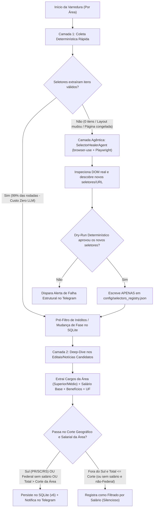

# Plano de Evolução Agêntica — Monitor de Concursos

> [!IMPORTANT]
> **Ponto de Partida no Git:** Este plano está salvo sobre a branch mais avançada do repositório (`feat/pci-como-segunda-fonte-e-catchup`, commit base `fbfd6b1`), que já contém `PciScraper`, `PciNacionalScraper`, `saude_fontes`, deduplicação entre fontes (`mesma_entidade`), schema v5 do SQLite e 271 testes.

---

## 1. Diagnóstico dos Problemas Atuais

1. **Falso salário máximo e "Vários Cargos" (`PciScraper`, `PciNacionalScraper` e `GranScraper`):**
   - As listagens do PCI (`/cargos/<slug>` e `/concursos/nacional/`) e os cards de resumo do Gran mostram apenas a manchete geral do edital (ex.: *"salários de até R$ 15.034,81 para Vários Cargos"*).
   - O valor anunciado quase sempre corresponde ao cargo de maior topo do edital (ex.: Médico, Procurador), enquanto o cargo de TI ou Educação paga muito menos — ou nem sequer é detalhado se é de nível Médio/Técnico ou Superior.
2. **Ausência de filtro geográfico + corte salarial real (Base + Benefícios):**
   - Hoje o sistema notifica qualquer concurso da área, inclusive prefeituras fora do Sul pagando R$ 2.000,00, gerando ruído alto.
3. **Degradação da fonte Gran Concursos:**
   - O artigo `blog.grancursosonline.com.br/concursos-ti/` teve seu `dateModified` congelado em 12/06/2026.
   - As páginas `/cursos/carreira/*` passaram a exigir renderização JavaScript (retornam HTML vazio para `requests.get`).
   - A página `concursos-abertos/` é atualizada diariamente (~135 blocos), mas cada bloco `<h3>` na listagem contém apenas órgão, banca, vagas totais e maior salário geral — **sem listar os cargos**, fazendo o pré-filtro descartar editais de TI, Educação, Sociologia e Artes.
4. **Fragilidade de Seletores vs. Custo de LLM:**
   - Seletores estáticos quebram quando os portais mudam o DOM; por outro lado, rodar um agente de navegador com LLM em todas as páginas todos os dias teria custo e latência inviáveis (o slug `professor` no PCI tem >1.000 itens).

---

## 2. Arquitetura Proposta: Híbrida Determinística + Agêntica (`browser-use` + `Playwright`)

Para atingir o **balanceamento custo-benefício ideal a longo prazo**, o sistema será dividido em dois regimes de operação:



### 2.1. Registro Declarativo de Marcadores (`config/selectors_registry.json`)
Em vez de seletores CSS/tags hardcoded espalhados nos scrapers Python (`div.ca`, `ul.link-d`, `a.noticia_desc`, `h3`), todos os caminhos de extração ficam centralizados em `config/selectors_registry.json`:
- **Marcadores de Listagem:** seletores de container de item, título, link da notícia/artigo, prazo, UF e resumo para cada fonte (`gran_blog`, `gran_carreira`, `gran_abertos`, `pci_cargo`, `pci_nacional`).
- **Marcadores de Detalhe (Notícia/Artigo):** seletores do corpo do artigo, tabelas de cargos/remuneração e listas de benefícios (vale-alimentação, auxílio-refeição, gratificações).
- **Metadados de Saúde:** versão do seletor, data da última regeneração e taxa de sucesso.

### 2.2. Auto-Regeneração Agêntica (`src/intelligence/selector_healer.py`)
Quando um scraper determinístico falha na validação (retorna vazio, perde campos essenciais ou `saude_fontes` detecta estagnação):
1. O `SelectorHealerAgent` inicia o **Playwright** integrado ao **`browser-use`**.
2. O agente navega até a página-alvo, renderiza o JavaScript e localiza onde os concursos, cargos, links e salários estão agora no DOM.
3. No caso do Gran Concursos, se a URL de artigo curado estiver congelada, o agente também pode navegar pelo hub de concursos do Gran para descobrir a URL atualizada ou validar a extração via `/cursos/carreira/` e `concursos-abertos/`.
4. **Validação Determinística (Gatekeeper):** Antes de persistir qualquer seletor sugerido pelo agente, o Python executa o seletor proposto via BeautifulSoup/Playwright sobre o DOM capturado e verifica se ele retorna `N > 0` registros bem-formados.

### 2.3. Sandbox Estrito de Permissões do Agente
> [!CAUTION]
> O agente `browser-use` processa conteúdo HTML de terceiros (superfície de *prompt injection*). Por isso, ele **nunca** terá permissão para editar arquivos `.py` arbitrários, ler variáveis sensíveis (`.env` / `MONITOR_ENV_FILE`) ou executar comandos de terminal/shell.

O confinamento será implementado por construção no código Python:
- **Navegação Restrita (Allowlist de Domínios):** Contexto do Playwright intercepta rotas (`page.route`) permitindo apenas `*.grancursosonline.com.br` e `*.pciconcursos.com.br` (bloqueando downloads de executáveis, scripts externos desnecessários e POSTs autenticados).
- **Ações de Escrita Restritas aos Lugares-Alvo (`CustomController` do `browser-use`):**
  - O agente não possui ferramentas de sistema de arquivos (`write_file` / `bash` desativados).
  - Ele só pode finalizar devolvendo estruturas validadas por **Pydantic**, que o código determinístico grava **exclusivamente** em dois alvos:
    1. `config/selectors_registry.json` (com backup automático em `data/selectors_history/`).
    2. `data/concursos.db` (via [`DatabaseManager`](src/database/manager.py)) e caches JSON em `data/`.

---

## 3. Verificação Profunda de Cargos, Nível e Remuneração Real (Base + Benefícios)

### 3.1. Fim do "Vários Cargos" com Maior Salário Geral
Para todo concurso **inédito** (que ainda não está no SQLite nem no cache de descartados da área):
1. **Abertura da Página de Detalhes (`DetailExtractor`):**
   - No **PCI** (`pci` e `pci_nacional`): abre o link da notícia detalhada (`https://www.pciconcursos.com.br/noticias/...`).
   - No **Gran** (`concursos-abertos/`, `concursos-ti/`, `concursos-educacao/`, `/cursos/carreira/`): se o bloco da listagem não contiver os cargos específicos e seus salários, segue o link do artigo específico do concurso no blog do Gran (com Playwright fallback caso a página exija JS).
2. **Extração Específica por Área:**
   - Primeiro tenta extrair tabelas/listas de cargos deterministicamente usando os marcadores de detalhe de `config/selectors_registry.json`.
   - Em seguida, passa o extrato enxuto dos cargos/remuneração pela [`IntelligenceUnit`](src/intelligence/langchain_unit.py) (ou extração estruturada via `browser-use` se a página exigir interação como abas/accordions de cargos), exigindo o seguinte contrato JSON:
     ```json
     {
       "ignorar": false,
       "nome": "DATAPREV",
       "esfera": "federal",
       "uf": "DF",
       "abrangencia_sul": true,
       "fase": "inscricoes_abertas",
       "data_fim_inscricao": "2026-08-06",
       "data_referencia": "2026-09-20",
       "cargos_area": [
         {
           "cargo": "Analista de Tecnologia da Informação - Desenvolvimento",
           "nivel": "superior",
           "vagas": "120 + CR",
           "salario_base": 8747.61,
           "beneficios": 1480.00,
           "descricao_beneficios": "Auxílio-alimentação R$ 1.100 + Cesta R$ 380",
           "remuneracao_total": 10227.61,
           "salario_estimado_ultimo_edital": false
         },
         {
           "cargo": "Técnico de Informática",
           "nivel": "medio_tecnico",
           "vagas": "15",
           "salario_base": 4200.00,
           "beneficios": 1480.00,
           "descricao_beneficios": "Auxílio-alimentação R$ 1.100 + Cesta R$ 380",
           "remuneracao_total": 5680.00,
           "salario_estimado_ultimo_edital": false
         }
       ],
       "maior_remuneracao_area": 10227.61,
       "status": "Resumo focado apenas nas vagas da área alvo"
     }
     ```
   - **Concursos sem edital publicado (`previsto` / `banca_definida`):** O extrator e o prompt buscarão ativamente na notícia a **estimativa salarial / remuneração do último edital** somada aos benefícios para compor `remuneracao_total`. Caso a notícia não traga nenhuma estimativa salarial, o concurso será **desconsiderado**, **exceto se for Federal (`esfera == "federal"`) ou do Sul (`PR`, `SC`, `RS`)**, que entram sempre.
3. **Otimização de Custo no PCI por Cargo (`/cargos/<slug>`):**
   - No `PciScraper` (onde `professor` tem >1.000 itens), **antes** de abrir a notícia ou chamar a LLM, aplicamos um pré-filtro rápido no título da listagem (`title="... salários de até R$ 3.500,00"`):
     - Se o concurso **não é do Sul** (`UF not in {'PR', 'SC', 'RS'}`), **não é Federal**, e o teto salarial anunciado na própria listagem já é muito inferior ao corte da área (ex.: teto geral do edital é R$ 3.200 quando o corte é R$ 5.000 ou R$ 9.000, mesmo considerando margem de benefícios), ele é descartado imediatamente em **0 ms e 0 chamadas HTTP/LLM**!
     - Apenas candidatos do Sul, Federais ou candidatos fora do Sul cujo teto possa atingir o corte abrem a página da notícia para apurar o salário exato do cargo da área + benefícios.

---

## 4. Regras de Corte Salarial, Esfera e Geografia por Área

A configuração multi-área em [`config/loader.py`](config/loader.py) e [`.env.example`](.env.example) passará a suportar `corte_salarial_fora_sul` e `ufs_sem_corte` (padrão `["PR", "SC", "RS"]`):

### 4.1. Matriz de Elegibilidade Salarial e Geográfica
1. **Concursos do Sul (`PR`, `SC`, `RS` ou lotação no Sul) OU Federais sem salário divulgado ainda:**
   - **Região Sul:** **Sempre entram** (sem corte salarial, com ou sem edital/salário divulgado).
   - **Federais (`esfera == "federal"`):** Se ainda não tiverem edital/salário estimado na notícia, **sempre entram**. Se tiverem salário/estimativa na notícia, entram sempre que forem de abrangência nacional/Sul ou superarem o corte da área.
2. **Concursos pré-edital fora do Sul (Estaduais/Municipais):**
   - Verifica a estimativa salarial na notícia (geralmente baseada no último edital + benefícios).
   - Se a estimativa somada superar o corte da área (`> R$ 9.000` em TI; `> R$ 5.000` em Educação/Sociologia/Artes), **entra**.
   - Se **não houver estimativa salarial** na notícia (ou se for `<= corte`), **desconsidera**.

| Área (`area`) | Nome de Exibição | Cargos-Alvo (Superior / Médio / Técnico) | Regra no Sul (`PR`, `SC`, `RS`) | Pré-Edital sem Salário na Notícia | Regra Fora do Sul (`Base + Benefícios` da área, atual ou estimado) | Fontes Ativas |
| :--- | :--- | :--- | :--- | :--- | :--- | :--- |
| **`TI`** | Tecnologia da Informação | Analista de TI/Sistemas, Desenvolvedor, Programador, Segurança da Informação, Redes, Suporte, Técnico em Informática (Superior e Médio/Técnico) | **Sempre entra** | Entra **apenas se Federal ou do Sul** (demais descartados) | **Acima de R$ 9.000,00** (`> 9000.00`) | Gran (`concursos-ti/` + `concursos-abertos/` + carreira TI) + PCI Slugs TI (8 slugs) + PCI Nacional |
| **`EDUCACAO`** | Educação | Professor, Pedagogo, Professor de Educação Básica, Supervisor Escolar, Orientador Educacional, Coordenador Pedagógico | **Sempre entra** | Entra **apenas se Federal ou do Sul** (demais descartados) | **Acima de R$ 5.000,00** (`> 5000.00`) | Gran (`concursos-educacao/` + `concursos-abertos/` + carreira Educação) + PCI Slugs Educação (5 slugs) + PCI Nacional |
| **`SOCIOLOGIA_ARTES`** | Sociologia, Artes e Licenciaturas | Professor de Sociologia, Sociólogo, Antropólogo, Professor de Artes, Arte-Educador, Professor de Filosofia, Licenciaturas | **Sempre entra** | Entra **apenas se Federal ou do Sul** (demais descartados) | **Acima de R$ 5.000,00** (`> 5000.00`) | Gran (`concursos-abertos/` + `concursos-educacao/`) + PCI Slugs Soc/Artes (`professor-de-sociologia`, `sociologo`, `professor-de-artes`, `arte-educador`, `professor-de-filosofia`) + PCI Nacional |

### Como os Cards do Telegram Serão Formatados
Em vez de um status genérico, a mensagem no Telegram trará explicitamente o detalhamento dos cargos da área:
- **🏛 Instituição / UF:** Ex.: `DATAPREV (Nacional / Lotação Sul disponível)` ou `Prefeitura de Campinas - SP`
- **💼 Cargos da Área e Escolaridade:**
  - `• Analista de TI (Superior) — R$ 8.747,61 + R$ 1.480,00 (benefícios) = R$ 10.227,61`
  - `• Técnico de Informática (Médio/Técnico) — R$ 4.200,00 + R$ 1.480,00 = R$ 5.680,00`
- **📊 Fase e 📅 Inscrições até:** Mantém o controle por vocabulário fechado e botões interativos (`⭐ Seguir` / `❌ Ignorar`).

---

## 5. Recuperação do Gran Concursos (`src/scrapers/gran_scraper.py`)

1. **Suporte a páginas dinâmicas (JS) com Playwright:**
   - Se `get_html()` via `requests` retornar menos blocos que o mínimo esperado ou se a página estiver marcada como `requires_js: true` no `selectors_registry.json` (como `/cursos/carreira/`), o `GranScraper` usa o cliente Playwright headless para renderizar o DOM completo antes de fatiar.
2. **Extração em Dois Níveis (`concursos-abertos/` e artigos congelados):**
   - Como `concursos-ti/` pode ficar semanas sem atualização editorial pelo Gran, o alvo de `TI` (assim como `EDUCACAO` e `SOCIOLOGIA_ARTES`) passará a monitorar também os artigos individuais linkados a partir de `concursos-abertos/` e das páginas de carreira.
   - Para evitar abrir mais de 100 links de artigos do Gran toda madrugada, criaremos um índice leve de links já inspecionados (`data/gran_artigos_cache.json`, chaveado por `url_artigo + hash_resumo_capa`): o bot só entra no artigo individual do Gran quando um concurso **novo** surge na listagem ou quando seu resumo/status na listagem principal muda!

---

## 6. Mudanças Planejadas por Arquivo

1. **Sincronização Git:**
   - Atualizar a base local para `origin/feat/pci-como-segunda-fonte-e-catchup` (`fbfd6b1`).
2. **Novos Módulos:**
   - `config/selectors_registry.json` — Seletores CSS/XPath declarativos para Gran e PCI (listagens e páginas de detalhe).
   - `src/scrapers/playwright_fetcher.py` — Gerenciador enxuto de contexto Playwright headless com bloqueio de recursos pesados (imagens/fontes/ads) e allowlist de domínios.
   - `src/scrapers/detail_extractor.py` — Extrator de detalhes de página de concurso (abre notícia do PCI ou artigo do Gran, extrai tabelas/texto de cargos, níveis, salários e benefícios).
   - `src/intelligence/selector_healer.py` — Integração `browser-use` + `Playwright` com `CustomController` restrito (apenas leitura do DOM + escrita validada em `config/selectors_registry.json` ou retorno estruturado Pydantic).
   - `src/utils/salario.py` — Parser determinístico de valores monetários em reais (`R$ X.XXX,XX`), cálculo de teto preliminar na listagem, soma de benefícios e regra de corte geográfico (`Sul` vs. `Fora do Sul`).
3. **Módulos Existentes a Atualizar:**
   - [`config/loader.py`](config/loader.py) e [`.env.example`](.env.example) — Adição de `corte_salarial_fora_sul` (`9000` para TI, `5000` para Educação e Sociologia/Artes), `ufs_sem_corte` (`["PR", "SC", "RS"]`), e URLs/slugs atualizados para as 3 áreas.
   - [`src/scrapers/gran_scraper.py`](src/scrapers/gran_scraper.py) — Leitura de marcadores via `selectors_registry.json`, fallback via Playwright para páginas JS e navegação em 2 níveis (`listagem → artigo individual`) com cache de artigos já lidos.
   - [`src/scrapers/pci_scraper.py`](src/scrapers/pci_scraper.py) e [`src/scrapers/pci_nacional_scraper.py`](src/scrapers/pci_nacional_scraper.py) — Leitura de seletores via `selectors_registry.json`, pré-filtro rápido por teto salarial na listagem (evitando abrir centenas de prefeituras fora do Sul que pagam abaixo do corte) e enriquecimento completo de cargos/níveis/benefícios para candidatos elegíveis.
   - [`src/intelligence/langchain_unit.py`](src/intelligence/langchain_unit.py) — Atualização do prompt e schema JSON para extrair `cargos_area` (com `cargo`, `nivel`, `salario_base`, `beneficios`, `remuneracao_total`), `esfera`, `uf` e `abrangencia_sul`.
   - [`src/database/manager.py`](src/database/manager.py) — Migração aditiva para **schema v6**: colunas `uf`, `cargos_json`, `remuneracao_max_area` (permitindo auditoria e exibição rica nos cards).
   - [`src/core/bot.py`](src/core/bot.py) — Integração do filtro de corte salarial/geográfico, acionamento automático do `SelectorHealerAgent` quando uma fonte falhar na extração estrutural, e novo layout do card no Telegram detalhando cargos (Superior/Médio) e remuneração somada.
   - [`requirements.txt`](requirements.txt) — Inclusão de `playwright`, `browser-use` e `pydantic`.
   - `tests/` — Testes unitários para cálculo salarial/benefícios, corte geográfico (TI R$ 9k vs. Educação/Soc/Artes R$ 5k), extração em 2 níveis do Gran, sandbox de permissões do `SelectorHealerAgent` e migração v6 do banco.
