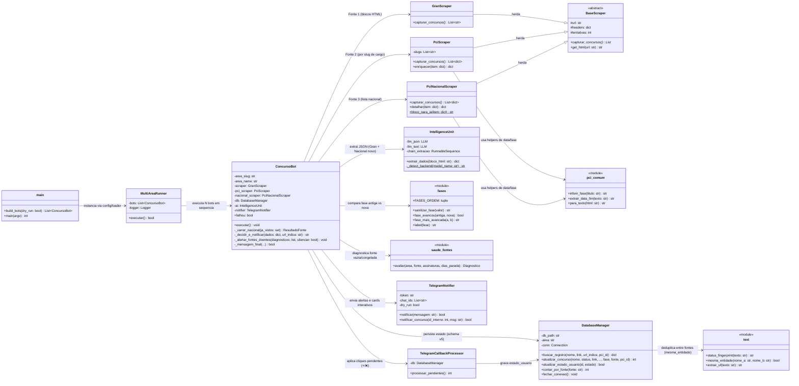

# 🎯 Monitor de Concursos (TI + Multi-Área) — Arquitetura Híbrida AI-First & Determinística


Sistema automatizado de engenharia de dados e IA para monitorar, classificar e notificar atualizações de concursos públicos em múltiplas áreas (**Tecnologia da Informação**, **Educação**, **Sociologia, Artes e Licenciaturas**), com roteamento independente de mensagens por chat do Telegram.

Combina **extração semântica via LLM (AI-First)** onde o HTML é prosa livre com **parsing determinístico de alta velocidade** onde o volume exige escala (milhares de editais municipais/estaduais), convergindo em uma única **máquina de estados de fases** com deduplicação cruzada entre fontes e autodiagnóstico de saúde operacional.

> 📌 **Próxima Geração (Em Planejamento):** Veja o documento [PLANO_EVOLUCAO_AGENTICA.md](PLANO_EVOLUCAO_AGENTICA.md) com o projeto da evolução agêntica usando **`browser-use` + `Playwright`** para auto-regeneração de seletores (Self-Healing DOM), inspeção profunda de salários + benefícios por cargo (Superior/Médio) e corte geográfico/salarial por área.

---

## ✨ Destaques de Engenharia

- **Ingestão Multi-Fonte Complementar (3 Portas de Entrada):**
  1. **Gran Cursos Blog (`GranScraper`):** Fatiamento em blocos `<h3>` + extração semântica via LLM — cobre grandes concursos estaduais e federais.
  2. **PCI Concursos por Cargo (`PciScraper`):** Parsing determinístico em `/cargos/<slug>` + enriquecimento sob demanda da data de inscrição na notícia — cobre toda a camada municipal, autarquias e conselhos (processa >1.000 concursos no slug `professor` em milissegundos, a custo zero de LLM).
  3. **PCI Concursos Nacional (`PciNacionalScraper`):** Monitoramento de `/concursos/nacional/` — captura estatais federais de grande porte (ex.: Dataprev, Transpetro, Correios, BNDES) onde a coluna de cargos traz `"Vários Cargos"`. Usa calendário determinístico da listagem + 1 chamada de LLM apenas para itens inéditos (com cache de descartes por 30 dias em `data/pci_nacional_descartados.json`).
- **Máquina de Estados por Fase Estruturada (Anti-Flapping):**
  - Em vez de comparar texto livre (que a LLM reescreve a cada leitura, gerando falsos positivos), cada concurso é classificado num vocabulário fechado e ordenado:
    `previsto → banca_definida → edital_publicado → inscricoes_abertas → inscricoes_encerradas → concluido`
  - Apenas **avanço real de fase** ou **mudança na janela de inscrição** dispara alerta `🔔 ATUALIZAÇÃO`. Regressões acidentais da LLM são absorvidas (`fase_mais_avancada`).
- **Resolução e Fusão de Entidades entre Fontes (`mesma_entidade`):**
  - Um mesmo concurso capturado pelo Gran (`"Prefeitura de Ponta Grossa - PR"`) e pelo PCI (`"Concurso Prefeitura Ponta Grossa"`) é reconciliado por tokens discriminantes e validação de UF (impedindo colisões falsas como *"Ponta Grossa"* vs. *"Ponta Porã"*). Duplicatas históricas do mesmo órgão são fundidas no SQLite preservando a preferência do usuário (`⭐ Seguindo` > `❌ Ignorado` > `Ativo`).
- **Observabilidade e Saúde por Fonte (`saude_fontes`):**
  - Detecta individualmente quando uma fonte fica **vazia (`🕳️`)** ou **congelada (`🧊`)** devolvendo o mesmo conteúdo visível por mais de `dias_fonte_parada` dias (padrão: 21 dias), mesmo quando as outras fontes continuam trazendo novidades.
  - Detecta **extração degradada (`🚨`)** quando $\ge 20\%$ dos blocos falham na LLM e inclui um **Dead-Man's-Switch (`⏰`)** no agendador Linux caso o bot fique mais de $N$ dias sem concluir uma varredura.
- **Interatividade no Telegram:**
  - Botões inline em cada notificação (`⭐ Seguir` / `❌ Não tenho interesse`) processados em lote via `getUpdates` no início de cada varredura, sem exigir servidor web ou webhook exposto.
- **Três Backends de LLM Selecionáveis (`LLM_MODEL`):**
  - **Ollama** (local, custo zero), **LiteLLM** (APIs remotas: Anthropic, OpenAI, MiniMax, etc.) ou **Claude Code CLI** (`claude -p` via assinatura local).

---

## 🏛️ Arquitetura — Três Fontes, Um Único Caminho de Decisão

| Característica | 1. Gran Blog (`GranScraper`) | 2. PCI por Cargo (`PciScraper`) | 3. PCI Nacional (`PciNacionalScraper`) |
|---|---|---|---|
| **Endpoint** | 1 página de blog por área | `/cargos/<slug>` (N slugs por área) | `/concursos/nacional/` |
| **Formato da Página** | Prosa livre em HTML | Lista estruturada (`ul.link-d` + `ul.link-i`) | Cards estruturados (`div.ca`) |
| **Usa LLM?** | **Sim** (1 chamada por bloco pós-filtro) | **Não** (100% determinístico) | **Apenas para item inédito** (julga aderência à área) |
| **Volume Típico** | ~45 blocos | 50 a 1.100+ itens por área | ~4 a 15 itens |
| **Cobertura Principal** | Grandes editais estaduais/federais | Prefeituras, câmaras, autarquias, conselhos | **Estatais federais** (Dataprev, Transpetro, Correios) |
| **Chave Primária de Dedup** | `link` canônico + `(area, nome)` | `pci_id` (`nXXXXXX`) + `link` | `link` da notícia (compartilhado com `PciScraper`) |

### Fluxo de Dados do Pipeline

```text
main.py (--dry-run opcional | carrega MONITOR_ENV_FILE ou .env)
  │
  ▼
MultiAreaRunner ──▶ executa N ConcursoBots em sequência (TI, EDUCACAO, SOCIOLOGIA_ARTES...)
  │
  ▼
ConcursoBot (Orquestrador por Área)
  │
  ├──▶ 1. TelegramCallbackProcessor.processar_pendentes()
  │         Aplica cliques pendentes (⭐ Seguir / ❌ Ignorar) no SQLite antes da varredura
  │
  ├──▶ 2. Coleta Multi-Fonte:
  │      ├─▶ [Fonte 1: GranScraper] ──▶ Blocos <h3> ──▶ Filtro rápido texto visível ──▶ IntelligenceUnit (LLM JSON)
  │      ├─▶ [Fonte 2: PciScraper]  ──▶ /cargos/<slug> (Determinístico) ──▶ enriquecer() prazo na notícia (só inéditos)
  │      └─▶ [Fonte 3: PciNacional] ──▶ /concursos/nacional/ ──▶ Cache descartes (30d) ──▶ detalhar() + LLM (só inéditos)
  │
  ├──▶ 3. DatabaseManager.buscar_registro(nome, link, url_indice, pci_id)
  │         Resolução de identidade: pci_id ──▶ link específico ──▶ (area, nome) NOCASE ──▶ mesma_entidade()
  │
  ├──▶ 4. ConcursoBot._decidir_e_notificar(dados)
  │         Matriz determinística por fase (previsto..concluido), prazo de inscrição e filtro de listagem morta
  │
  ├──▶ 5. TelegramNotifier (Cards individuais com botões ⭐/❌ ou Resumo por UF na 1ª carga do PCI)
  │
  └──▶ 6. Diagnóstico Operacional (Agregado + Por Fonte via saude_fontes)
            Envia Heartbeat ✅, Alerta de Perda 🚨 (>=20% erros), Varredura Cega ⚠️, Fonte Vazia 🕳️ ou Fonte Parada 🧊
```

---

## 📐 Diagrama de Classes (Mermaid)



---

## 📂 Estrutura do Projeto

```text
monitor_concursos_ti/
├── main.py                           # Ponto de entrada single-run (suporta --dry-run e MONITOR_ENV_FILE)
├── requirements.txt                  # Dependências de produção
├── requirements-dev.txt              # Dependências de teste (pytest, pytest-mock, pytest-cov)
├── .env.example                      # Template completo de configuração (multi-área, PCI, LLMs)
├── PLANO_EVOLUCAO_AGENTICA.md        # Roadmap da evolução agêntica (browser-use + Playwright + corte salarial)
├── CLASS_DIAGRAM.md                  # Diagrama de classes Mermaid isolado
├── CLAUDE.md                         # Guia técnico profundo da arquitetura e decisões de design
├── config/
│   └── loader.py                     # Carregador e validador de alvos (MONITOR_TARGETS_JSON e modo legado)
├── data/
│   ├── concursos.db                  # Banco SQLite (schema v5, migração automática v1→v5)
│   ├── saude_fontes.json             # Histórico de hashes/dias sem mudança por fonte
│   ├── pci_nacional_descartados.json # Memoização de editais nacionais fora da área (TTL 30 dias)
│   └── telegram_offset.json          # Offset de polling de botões interativos do Telegram
├── logs/
│   └── bot_concursos.log             # Logs rotativos + marcadores diários de execução/alerta
├── scripts/
│   ├── install_schedule.ps1          # Agendamento no Windows Task Scheduler (com StartWhenAvailable)
│   ├── run_daily.bat                 # Wrapper de execução diária no Windows
│   ├── install_schedule.sh           # Agendamento no Linux via cron horário + @reboot
│   ├── run_daily.sh                  # Wrapper Linux: 1 sucesso/dia + catch-up horário + dead-man's-switch
│   ├── export_known.py               # Exporta acervo ativo do SQLite em Markdown para auditoria externa
│   └── dedupe_db.py                  # Utilitário one-off de limpeza de duplicatas históricas
├── src/
│   ├── core/
│   │   ├── bot.py                    # ConcursoBot — Orquestrador multi-fonte, matriz de decisão e saúde
│   │   └── multi_area_runner.py      # MultiAreaRunner — Executa bots em sequência e agrega status de falha
│   ├── scrapers/
│   │   ├── base_scraper.py           # BaseScraper — ABC com retry HTTP, backoff e User-Agent
│   │   ├── gran_scraper.py           # GranScraper — Slicer de HTML por <h3> para artigos do Gran
│   │   ├── pci_scraper.py            # PciScraper — Parser determinístico de /cargos/<slug> + enriquecer()
│   │   ├── pci_nacional_scraper.py   # PciNacionalScraper — Parser de /concursos/nacional/ + bloco_para_ia()
│   │   └── pci_comum.py              # Inferência determinística de fase e extração de datas em frases de inscrição
│   ├── intelligence/
│   │   ├── langchain_unit.py         # IntelligenceUnit — Extração HTML → JSON sobre 3 backends de LLM
│   │   └── claude_cli_backend.py     # ClaudeCliLLM — Wrapper LangChain para `claude -p` via stdin
│   ├── database/
│   │   └── manager.py                # DatabaseManager — SQLite schema v5, resolução de identidade e fusão
│   ├── notifiers/
│   │   ├── telegram.py               # TelegramNotifier — Envio resiliente com botões inline e suporte a dry-run
│   │   └── telegram_callbacks.py     # TelegramCallbackProcessor — Processa cliques em ⭐ Seguir / ❌ Ignorar
│   └── utils/
│       ├── fases.py                  # Vocabulário controlado de 6 fases e comparação anti-regressão
│       ├── saude_fontes.py           # Diagnóstico de fonte vazia (🕳️) ou congelada (🧊)
│       ├── memoria_json.py           # Persistência atômica de caches JSON em data/
│       ├── text.py                   # mesma_entidade(), extrair_uf(), status_fingerprint() e normalização
│       └── logger.py                 # Configuração de RotatingFileHandler
└── tests/                            # Suíte automatizada com 272 testes (100% offline/mockada)
```

---

## 🧠 Decisões de Projeto & Matriz de Notificação

### Vocabulário Controlado de Fases (`src/utils/fases.py`)
```text
previsto ──▶ banca_definida ──▶ edital_publicado ──▶ inscricoes_abertas ──▶ inscricoes_encerradas ──▶ concluido
```

### Quando o Bot Notifica (`ConcursoBot._decidir_e_notificar`)

| Situação | Ação do Sistema |
|---|---|
| Concurso inédito, ativo ou previsto | Envia card **🆕 NOVO CONCURSO** (com fase, prazo e botões ⭐/❌) e salva no banco |
| Concurso inédito na 1ª carga do PCI (`pci_primeira_carga="resumo_uf"`) | Acumula e envia **📦 Resumo agrupado por Estado (UF)** para evitar flood inicial |
| Concurso inédito com inscrição já encerrada ou listagem morta (`data_referencia` passada) | Salva em silêncio no banco (sem notificar) |
| **Fase avançou** (ex.: `banca_definida` → `edital_publicado`) | Envia card **🔔 ATUALIZAÇÃO** mostrando a transição `Fase Antiga → Fase Nova` |
| **Prazo de inscrição mudou** (nova data válida diferente da anterior) | Envia card **🔔 ATUALIZAÇÃO** destacando o novo prazo |
| LLM apenas reescreveu o resumo ou regrediu a fase | Atualiza em silêncio preservando a `fase_mais_avancada` |
| Concurso marcado com **⭐ Seguir** pelo usuário | Notifica qualquer transição real, mesmo após o encerramento das inscrições |
| Concurso marcado com **❌ Não tenho interesse** | Ignora completamente em todas as rodadas futuras |
| Perda de $\ge 20\%$ dos blocos na extração via IA | Dispara alerta **🚨 Extração Degradada** e retorna exit code `1` (para retry horário) |
| Varredura sem candidatos válidos (em alvo não filtrado) | Dispara alerta **⚠️ Varredura Cega** (rate-limited a 1x/dia) |
| Uma fonte específica não retornou itens ou está congelada há $>21$ dias | Dispara alerta **🕳️ Fonte sem retorno** ou **🧊 Fonte parada** apontando a URL exata |
| Varredura concluída sem novidades e fontes saudáveis | Envia heartbeat **✅ Varredura Concluída** |

---

## 🛠️ Instalação e Configuração

### 1. Pré-requisitos e Ambiente Virtual

```bash
git clone https://github.com/lucasmsorrentino/monitor_concursos_ti.git
cd monitor_concursos_ti

python -m venv .venv
# Windows (Git Bash / PowerShell):
source .venv/Scripts/activate   # ou .\.venv\Scripts\Activate.ps1
# Linux / macOS:
source .venv/bin/activate

pip install -r requirements.txt
```

### 2. Configuração (`.env` ou `MONITOR_ENV_FILE`)

Copie `.env.example` para `.env` (em desenvolvimento local) ou aponte a variável de ambiente `MONITOR_ENV_FILE` para um arquivo de segredos externo ao repositório (ex.: `~/concursos-secrets/monitor.env` com `chmod 600` em produção):

```bash
cp .env.example .env
```

> **Atenção:** `MONITOR_TARGETS_JSON` deve ficar em **uma única linha** no `.env` (limitação do `python-dotenv`).

Exemplo de configuração para múltiplas áreas (`TI`, `EDUCACAO`, `SOCIOLOGIA_ARTES`) combinando Gran Cursos + PCI por Cargo + PCI Nacional:

```ini
TELEGRAM_TOKEN=seu_token_telegram
LLM_MODEL=claude-cli:haiku
LLM_TIMEOUT_S=120
LLM_RETRIES=2
LLM_RETRY_DELAY_S=2

MONITOR_TARGETS_JSON=[{"area": "TI", "display_name": "Tecnologia da Informacao", "url": "https://blog.grancursosonline.com.br/concursos-ti/", "chat_ids": ["SEU_CHAT_ID"], "keywords_include": ["ti", "tecnologia", "informacao", "sistemas"], "keywords_exclude": ["sociologia", "artes", "pedagogia"], "pci_slugs": ["analista-de-sistemas", "tecnico-em-informatica", "tecnologia-da-informacao", "desenvolvedor", "programador", "seguranca-da-informacao", "redes", "suporte-tecnico"], "pci_nacional": true, "pci_primeira_carga": "individual"}, {"area": "EDUCACAO", "display_name": "Educacao", "url": "https://blog.grancursosonline.com.br/concursos-educacao/", "chat_ids": ["CHAT_ID_EDUCACAO"], "keywords_include": [], "keywords_exclude": [], "pci_slugs": ["professor", "pedagogo", "professor-de-educacao-basica", "supervisor-escolar", "orientador-educacional"], "pci_primeira_carga": "resumo_uf"}, {"area": "SOCIOLOGIA_ARTES", "display_name": "Sociologia, Artes e Licenciaturas", "url": "https://blog.grancursosonline.com.br/concursos-abertos/", "chat_ids": ["CHAT_ID_EDUCACAO"], "keywords_include": ["sociologia", "antropologia", "artes", "licenciatura"], "keywords_exclude": [], "pci_slugs": ["professor-de-artes", "professor-de-sociologia", "professor-de-filosofia", "arte-educador"], "pci_primeira_carga": "resumo_uf"}]
```

### 3. Backends de LLM Suportados

O backend é selecionado automaticamente pelo formato de `LLM_MODEL`:

| Formato de `LLM_MODEL` | Backend | Custo Marginal | Latência | Requisitos |
|---|---|---|---|---|
| `llama3.1`, `qwen2.5:7b` (sem `/`) | **Ollama Local** | Zero | Baixa | Servidor Ollama local ativo (`OLLAMA_BASE_URL`) |
| `anthropic/claude-haiku-4-5-...`, `openai/gpt-4o-mini` | **LiteLLM (API)** | Por token | Muito baixa | Chave de API do provedor no ambiente |
| `claude-cli:haiku` (`sonnet` / `opus`) | **Claude Code CLI** | Zero (assinatura) | Média/Alta | Binário `claude` autenticado no `PATH` |

---

## 🚀 Como Executar

### Execução Manual e Modo `--dry-run`

```bash
# Simulação segura (varre todas as fontes e loga decisões sem gravar no banco nem enviar Telegram):
python main.py --dry-run

# Execução real (varredura única em todas as áreas configuradas):
python main.py
```

### Agendamento Automático

- **Linux (`cron` com Catch-Up Horário + `@reboot` + Dead-Man's-Switch):**
  ```bash
  ./scripts/install_schedule.sh        # Instala tick horário no minuto 20 + @reboot
  crontab -l                           # Inspecionar entradas instaladas
  ./scripts/install_schedule.sh --remove
  ```
  O wrapper `scripts/run_daily.sh` roda de hora em hora, mas grava um marcador diário (`.last_success_date`) após a primeira execução bem-sucedida do dia — os ticks seguintes saem imediatamente em 3 linhas. Se o computador estava desligado de madrugada ou se uma rodada falhar (`exit != 0`), a hora seguinte faz o *catch-up* automaticamente.

- **Windows (`Task Scheduler` com `StartWhenAvailable`):**
  ```powershell
  .\scripts\install_schedule.ps1
  .\scripts\install_schedule.ps1 -Time 04:30
  ```

---

## 🧪 Testes Automatizados

A suíte conta com **272 testes unitários e de integração** (`pytest` + `pytest-mock`), 100% determinísticos e sem dependência de rede ou LLM ao vivo:

```bash
pip install -r requirements-dev.txt
pytest                                     # Roda os 272 testes
pytest --cov=src --cov=config              # Com relatório de cobertura
```

| Arquivo de Teste | Escopo Coberto |
|---|---|
| `test_concurso_bot.py` | Fluxo ponta a ponta: 3 fontes, matriz de decisão por fase, listagem morta, 1ª carga por UF, extração degradada, alertas de saúde e dry-run |
| `test_pci_scraper.py` | Parsing determinístico de `/cargos/<slug>`, deduplicação intra-rodada por `pci_id`, extração de prazo na notícia (`enriquecer`) |
| `test_pci_nacional_scraper.py` | Parsing de `/concursos/nacional/`, precedência de janela de inscrição sobre verbo do título, montagem de bloco para IA |
| `test_saude_fontes.py` | Detecção de fonte vazia (`🕳️`), fonte congelada por dias (`🧊`), insensibilidade à ordem dos blocos |
| `test_database_manager.py` | Criação e migração automática de schema `v1 → v5`, resolução de identidade em 4 níveis, fusão automática de órgãos duplicados (`_fundir`) |
| `test_intelligence_unit.py` | Roteamento entre Ollama, LiteLLM e Claude CLI, sanitização de datas/fases, retry e sinalização de erro (`erro: True`) |
| `test_gran_scraper.py` | Fatiamento HTML por `<h3>`, páginas de carreira e filtros de ruído |
| `test_telegram_notifier.py` | Roteamento multi-chat, botões inline (`⭐`/`❌`), resiliência HTTP e modo `dry_run` |
| `test_telegram_callbacks.py` | Polling de `getUpdates`, transição de `estado_usuario` no banco e persistência de offset |
| `test_claude_cli_backend.py` | Invocação via `stdin`, timeouts, parsing de aliases (`haiku`/`sonnet`/`opus`) |
| `test_config_loader.py` | Parsing de `MONITOR_TARGETS_JSON`, slugs do PCI, flags nacionais e fallback legado |
| `test_text_utils.py` | Normalização sem acentos, `extrair_uf`, `status_fingerprint` e heurística `mesma_entidade` |
