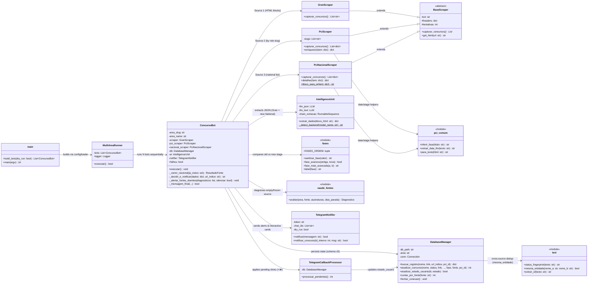

# 🎯 Public Job Exam Monitor (TI + Multi-Area) — Hybrid Deterministic & LLM Pipeline


Automated data engineering and LLM pipeline that monitors, classifies, and notifies updates on Brazilian public civil service exams (*concursos públicos*) across multiple career areas (**Information Technology**, **Education**, **Sociology, Arts & Teaching Degrees**), routing interactive alerts per area to dedicated Telegram chats.

Instead of relying solely on brittle CSS selectors or burning LLM tokens on every HTML row, the system uses a **hybrid deterministic + LLM architecture**: deterministic parsing handles high-volume structured listings (1,000+ exams per scan in milliseconds at zero LLM cost), while an LLM (via Ollama, LiteLLM, or Claude Code CLI) is invoked only where unstructured prose requires semantic extraction or area classification. All sources converge into a single **ordered stage state machine** with cross-source entity deduplication and per-source health diagnostics.

> 📌 **Next-Generation Roadmap:** See [PLANO_EVOLUCAO_AGENTICA.md](PLANO_EVOLUCAO_AGENTICA.md) for the planned agentic evolution using **`browser-use` + `Playwright`** for self-healing DOM selectors, deep-dive role/salary/benefits inspection, and regional salary cutoffs.

---

## ✨ Engineering Highlights

- **Complementary Multi-Source Ingestion (3 Entry Doors):**
  1. **Gran Cursos Blog (`GranScraper`):** Slices editorial HTML into `<h3>` blocks + visible-text keyword pre-filter + LLM JSON extraction — covers major state and federal exams.
  2. **PCI Concursos by Role (`PciScraper`):** 100% deterministic parsing of `/cargos/<slug>` + on-demand news deadline regex enrichment — covers municipal, state, and regional council exams (processes 1,100+ items on the `professor` slug in milliseconds with zero LLM calls).
  3. **PCI Concursos National (`PciNacionalScraper`):** Monitors `/concursos/nacional/` — captures federal state-owned companies (e.g., Dataprev, Transpetro, Correios, BNDES) where the role column only states *"Vários Cargos"* (*Multiple Roles*). Uses deterministic calendar data from the listing + a single LLM call only for genuinely new items (with a 30-day off-area memoization cache in `data/pci_nacional_descartados.json`).
- **Deterministic Stage State Machine (Anti-Flapping):**
  - Free-text status comparison caused false positives whenever the LLM reworded a summary. Instead, each exam is classified into a closed, ordered vocabulary:
    `previsto → banca_definida → edital_publicado → inscricoes_abertas → inscricoes_encerradas → concluido`
  - Only a **strict stage advance** or a **registration deadline change** triggers a `🔔 ATUALIZAÇÃO` alert. LLM regressions are absorbed (`fase_mais_avancada`).
- **Cross-Source Entity Resolution & Auto-Merge (`mesma_entidade`):**
  - The same agency captured from Gran (`"Prefeitura de Ponta Grossa - PR"`) and PCI (`"Concurso Prefeitura Ponta Grossa"`) is matched by discriminating tokens and state (`UF`) validation (preventing false merges such as *"Ponta Grossa"* vs. *"Ponta Porã"*). Duplicate rows are automatically merged in SQLite while preserving user button priority (`⭐ Following` > `❌ Ignored` > `Active`).
- **Per-Source Health Diagnostics (`saude_fontes`) & Operational Guardrails:**
  - Independently flags a source that returns **empty (`🕳️`)** or remains **frozen (`🧊`)** with identical visible content for more than `dias_fonte_parada` days (default: 21), even when other sources keep delivering updates.
  - Sends a **Degraded Extraction (`🚨`)** alert when $\ge 20\%$ of blocks fail LLM extraction and includes a **Dead-Man's-Switch (`⏰`)** in the Linux cron wrapper if no successful scan has occurred for $N$ days.
- **Interactive Telegram Controls:**
  - Inline buttons on every card (`⭐ Follow` / `❌ Not interested`) polled in batch via `getUpdates` at the start of each run — no exposed webhook or daemon required.

---

## 🏛️ Architecture — Three Sources, One Decision Path

| Feature | 1. Gran Blog (`GranScraper`) | 2. PCI by Role (`PciScraper`) | 3. PCI National (`PciNacionalScraper`) |
|---|---|---|---|
| **Endpoint** | 1 blog page per area | `/cargos/<slug>` (N slugs per area) | `/concursos/nacional/` |
| **Page Structure** | Free-form HTML prose | Structured list (`ul.link-d` + `ul.link-i`) | Structured cards (`div.ca`) |
| **Uses LLM?** | **Yes** (1 call per post-filter block) | **No** (100% deterministic) | **Only for NEW items** (judges area fit) |
| **Typical Volume** | ~45 blocks | 50 to 1,100+ items per area | ~4 to 15 items |
| **Primary Coverage** | Large state/federal exams | Municipalities, councils, state agencies | **Federal state-owned enterprises** (Dataprev, Transpetro) |
| **Primary Dedup Key** | Canonical `link` + `(area, nome)` | `pci_id` (`nXXXXXX`) + `link` | News `link` (shared with `PciScraper`) |

### Pipeline Data Flow

```text
main.py (optional --dry-run | loads MONITOR_ENV_FILE or .env)
  │
  ▼
MultiAreaRunner ──▶ runs N ConcursoBots sequentially (TI, EDUCACAO, SOCIOLOGIA_ARTES...)
  │
  ▼
ConcursoBot (Per-Area Orchestrator)
  │
  ├──▶ 1. TelegramCallbackProcessor.processar_pendentes()
  │         Applies pending button clicks (⭐ Follow / ❌ Ignore) to SQLite before scanning
  │
  ├──▶ 2. Multi-Source Ingestion:
  │      ├─▶ [Source 1: GranScraper] ──▶ <h3> blocks ──▶ Visible-text keyword filter ──▶ IntelligenceUnit (LLM JSON)
  │      ├─▶ [Source 2: PciScraper]  ──▶ /cargos/<slug> (Deterministic) ──▶ enriquecer() deadline on news page (new only)
  │      └─▶ [Source 3: PciNacional] ──▶ /concursos/nacional/ ──▶ 30d discard cache ──▶ detalhar() + LLM (new only)
  │
  ├──▶ 3. DatabaseManager.buscar_registro(nome, link, url_indice, pci_id)
  │         Identity resolution: pci_id ──▶ specific link ──▶ (area, nome) NOCASE ──▶ mesma_entidade()
  │
  ├──▶ 4. ConcursoBot._decidir_e_notificar(dados)
  │         Deterministic decision matrix by stage (previsto..concluido), deadline, and dead-listing filter
  │
  ├──▶ 5. TelegramNotifier (Individual cards with ⭐/❌ buttons or State/UF summary on PCI first load)
  │
  └──▶ 6. Operational Health Diagnostics (Aggregate + Per-Source via saude_fontes)
            Sends Heartbeat ✅, Degraded Alert 🚨 (>=20% errors), Blind Scan ⚠️, Empty Source 🕳️, or Frozen Source 🧊
```

---

## 📐 Class Diagram (Mermaid)



---

## 📂 Project Structure

```text
monitor_concursos_ti/
├── main.py                           # Single-run entry point (supports --dry-run and MONITOR_ENV_FILE)
├── requirements.txt                  # Production dependencies
├── requirements-dev.txt              # Test dependencies (pytest, pytest-mock, pytest-cov)
├── .env.example                      # Complete configuration template (multi-area, PCI, LLMs)
├── PLANO_EVOLUCAO_AGENTICA.md        # Agentic evolution roadmap (browser-use + Playwright + salary cutoffs)
├── CLASS_DIAGRAM.md                  # Standalone Mermaid class diagram
├── CLAUDE.md                         # Deep architectural & operational reference
├── config/
│   └── loader.py                     # Target loader & validator (MONITOR_TARGETS_JSON + legacy fallback)
├── data/
│   ├── concursos.db                  # SQLite database (schema v5, auto-migrates v1→v5)
│   ├── saude_fontes.json             # Per-source content digests and days-unchanged counters
│   ├── pci_nacional_descartados.json # Off-area national exam memoization (30-day TTL)
│   └── telegram_offset.json          # Telegram callback_query polling offset
├── logs/
│   └── bot_concursos.log             # Rotating logs + daily execution/alert markers
├── scripts/
│   ├── install_schedule.ps1          # Windows Task Scheduler installer (with StartWhenAvailable)
│   ├── run_daily.bat                 # Windows daily execution wrapper
│   ├── install_schedule.sh           # Linux hourly cron + @reboot installer
│   ├── run_daily.sh                  # Linux wrapper: 1 success/day + hourly catch-up + dead-man's-switch
│   ├── export_known.py               # Exports active SQLite exams to Markdown for external auditing
│   └── dedupe_db.py                  # One-off utility for historical duplicate cleanup
├── src/
│   ├── core/
│   │   ├── bot.py                    # ConcursoBot — Multi-source orchestrator, decision matrix & health
│   │   └── multi_area_runner.py      # MultiAreaRunner — Runs bots sequentially & aggregates failure state
│   ├── scrapers/
│   │   ├── base_scraper.py           # BaseScraper — ABC with HTTP retry, backoff & User-Agent
│   │   ├── gran_scraper.py           # GranScraper — HTML <h3> slicer for Gran Cursos articles
│   │   ├── pci_scraper.py            # PciScraper — Deterministic /cargos/<slug> parser + enriquecer()
│   │   ├── pci_nacional_scraper.py   # PciNacionalScraper — /concursos/nacional/ parser + bloco_para_ia()
│   │   └── pci_comum.py              # Shared deterministic stage inference & registration-sentence date parser
│   ├── intelligence/
│   │   ├── langchain_unit.py         # IntelligenceUnit — HTML → JSON extraction over 3 LLM backends
│   │   └── claude_cli_backend.py     # ClaudeCliLLM — LangChain wrapper for `claude -p` via stdin
│   ├── database/
│   │   └── manager.py                # DatabaseManager — SQLite schema v5, 4-tier identity resolution & merge
│   ├── notifiers/
│   │   ├── telegram.py               # TelegramNotifier — Resilient delivery with inline buttons & dry-run
│   │   └── telegram_callbacks.py     # TelegramCallbackProcessor — Applies ⭐ Follow / ❌ Ignore clicks
│   └── utils/
│       ├── fases.py                  # Controlled 6-stage vocabulary & anti-regression comparison
│       ├── saude_fontes.py           # Empty (🕳️) and frozen (🧊) source diagnostics
│       ├── memoria_json.py           # Atomic JSON cache persistence in data/
│       ├── text.py                   # mesma_entidade(), extrair_uf(), status_fingerprint() & normalization
│       └── logger.py                 # RotatingFileHandler setup
└── tests/                            # Automated suite with 272 unit & integration tests (100% offline/mocked)
```

---

## 🛠️ Setup, Configuration & Execution

```bash
git clone https://github.com/lucasmsorrentino/monitor_concursos_ti.git
cd monitor_concursos_ti

python -m venv .venv
source .venv/bin/activate          # Windows: .\.venv\Scripts\Activate.ps1
pip install -r requirements.txt
cp .env.example .env
```

### LLM Backend Selection (`LLM_MODEL`)

| `LLM_MODEL` Format | Backend | Marginal Cost | Latency | Notes |
|---|---|---|---|---|
| `llama3.1`, `qwen2.5:7b` (no `/`) | **Ollama Local** | Zero | Low | Requires local Ollama server (`OLLAMA_BASE_URL`) |
| `anthropic/claude-haiku-4-5-...`, `openai/gpt-4o-mini` | **LiteLLM (API)** | Per token | Very low | Requires provider API key in environment |
| `claude-cli:haiku` (`sonnet` / `opus`) | **Claude Code CLI** | Zero (subscription) | Medium/High | Uses authenticated `claude` binary on `PATH` |

### Running & Testing

```bash
# Safe simulation (scans all sources and logs decisions without DB writes or Telegram messages):
python main.py --dry-run

# Single production scan across all configured areas:
python main.py

# Run full test suite (272 tests, no network or LLM required):
pip install -r requirements-dev.txt
pytest
```

---

<details>
<summary><b>Versão em português</b></summary>

<br>

# 🎯 Monitor de Concursos (TI + Multi-Área) — Pipeline Híbrido Determinístico e LLM

Sistema automatizado de engenharia de dados e LLM para monitorar, classificar e notificar atualizações de concursos públicos em múltiplas áreas (**Tecnologia da Informação**, **Educação**, **Sociologia, Artes e Licenciaturas**), com roteamento independente de mensagens por chat do Telegram.

Em vez de depender apenas de seletores CSS frágeis ou gastar chamadas de LLM em cada linha de HTML, o sistema adota uma **arquitetura híbrida determinística + LLM**: o parsing determinístico processa listagens estruturadas de alto volume (mais de 1.000 editais por varredura em milissegundos, a custo zero de LLM), enquanto a LLM (via Ollama, LiteLLM ou Claude Code CLI) entra apenas onde o texto em prosa exige extração semântica ou classificação de área. Todas as fontes convergem para uma única **máquina de estados de fases** com deduplicação cruzada de órgãos e autodiagnóstico de saúde por fonte.

> 📌 **Próxima Geração (Em Planejamento):** Veja o documento [PLANO_EVOLUCAO_AGENTICA.md](PLANO_EVOLUCAO_AGENTICA.md) com o projeto da evolução agêntica usando **`browser-use` + `Playwright`** para auto-regeneração de seletores (Self-Healing DOM), inspeção profunda de salários + benefícios por cargo (Superior/Médio) e corte geográfico/salarial por área.

---

## ✨ Destaques de Engenharia

- **Ingestão Multi-Fonte Complementar (3 Portas de Entrada):**
  1. **Gran Cursos Blog (`GranScraper`):** Fatiamento em blocos `<h3>` + pré-filtro por texto visível + extração semântica via LLM — cobre grandes concursos estaduais e federais.
  2. **PCI Concursos por Cargo (`PciScraper`):** Parsing 100% determinístico em `/cargos/<slug>` + enriquecimento sob demanda da data de inscrição na notícia — cobre toda a camada municipal, autarquias e conselhos (processa >1.100 concursos no slug `professor` em milissegundos, sem chamar a LLM).
  3. **PCI Concursos Nacional (`PciNacionalScraper`):** Monitoramento de `/concursos/nacional/` — captura estatais federais de grande porte (ex.: Dataprev, Transpetro, Correios, BNDES) onde a coluna de cargos traz `"Vários Cargos"`. Usa calendário determinístico da listagem + 1 chamada de LLM apenas para itens inéditos (com cache de descartes por 30 dias em `data/pci_nacional_descartados.json`).
- **Máquina de Estados por Fase Estruturada (Anti-Flapping):**
  - Em vez de comparar texto livre (que a LLM reescreve a cada leitura, gerando falsos positivos), cada concurso é classificado num vocabulário fechado e ordenado:
    `previsto → banca_definida → edital_publicado → inscricoes_abertas → inscricoes_encerradas → concluido`
  - Apenas **avanço real de fase** ou **mudança na janela de inscrição** dispara alerta `🔔 ATUALIZAÇÃO`. Regressões acidentais da LLM são absorvidas (`fase_mais_avancada`).
- **Resolução e Fusão de Entidades entre Fontes (`mesma_entidade`):**
  - Um mesmo concurso capturado pelo Gran (`"Prefeitura de Ponta Grossa - PR"`) e pelo PCI (`"Concurso Prefeitura Ponta Grossa"`) é reconciliado por tokens discriminantes e validação de UF (impedindo colisões falsas como *"Ponta Grossa"* vs. *"Ponta Porã"*). Duplicatas históricas do mesmo órgão são fundidas no SQLite preservando a preferência do usuário (`⭐ Seguindo` > `❌ Ignorado` > `Ativo`).
- **Observabilidade e Saúde por Fonte (`saude_fontes`):**
  - Detecta individualmente quando uma fonte fica **vazia (`🕳️`)** ou **congelada (`🧊`)** devolvendo o mesmo conteúdo visível por mais de `dias_fonte_parada` dias (padrão: 21 dias), mesmo quando as outras fontes continuam trazendo novidades.
  - Detecta **extração degradada (`🚨`)** quando $\ge 20\%$ dos blocos falham na LLM e inclui um **Dead-Man's-Switch (`⏰`)** no agendador Linux caso o bot fique mais de $N$ dias sem concluir uma varredura.
- **Interatividade no Telegram:**
  - Botões inline em cada notificação (`⭐ Seguir` / `❌ Não tenho interesse`) processados em lote via `getUpdates` no início de cada varredura, sem exigir servidor web ou webhook exposto.

---

## 🧠 Matriz de Decisão e Notificação (`ConcursoBot._decidir_e_notificar`)

| Situação | Ação do Sistema |
|---|---|
| Concurso inédito, ativo ou previsto | Envia card **🆕 NOVO CONCURSO** (com fase, prazo e botões ⭐/❌) e salva no banco |
| Concurso inédito na 1ª carga do PCI (`pci_primeira_carga="resumo_uf"`) | Acumula e envia **📦 Resumo agrupado por Estado (UF)** para evitar flood inicial |
| Concurso inédito com inscrição já encerrada ou listagem morta (`data_referencia` passada) | Salva em silêncio no banco (sem notificar) |
| **Fase avançou** (ex.: `banca_definida` → `edital_publicado`) | Envia card **🔔 ATUALIZAÇÃO** mostrando a transição `Fase Antiga → Fase Nova` |
| **Prazo de inscrição mudou** (nova data válida diferente da anterior) | Envia card **🔔 ATUALIZAÇÃO** destacando o novo prazo |
| LLM apenas reescreveu o resumo ou regrediu a fase | Atualiza em silêncio preservando a `fase_mais_avancada` |
| Concurso marcado com **⭐ Seguir** pelo usuário | Notifica qualquer transição real, mesmo após o encerramento das inscrições |
| Concurso marcado com **❌ Não tenho interesse** | Ignora completamente em todas as rodadas futuras |
| Perda de $\ge 20\%$ dos blocos na extração via IA | Dispara alerta **🚨 Extração Degradada** e retorna exit code `1` (para retry horário) |
| Varredura sem candidatos válidos (em alvo não filtrado) | Dispara alerta **⚠️ Varredura Cega** (rate-limited a 1x/dia) |
| Uma fonte específica não retornou itens ou está congelada há $>21$ dias | Dispara alerta **🕳️ Fonte sem retorno** ou **🧊 Fonte parada** apontando a URL exata |
| Varredura concluída sem novidades e fontes saudáveis | Envia heartbeat **✅ Varredura Concluída** |

---

## 🛠️ Configuração e Agendamento

Copie `.env.example` para `.env` (em desenvolvimento local) ou aponte `MONITOR_ENV_FILE` para um arquivo de segredos externo ao repositório (ex.: `~/concursos-secrets/monitor.env` com `chmod 600` em produção).

> **Atenção:** `MONITOR_TARGETS_JSON` deve ficar em **uma única linha** no `.env` (limitação do `python-dotenv`).

```ini
TELEGRAM_TOKEN=seu_token_telegram
LLM_MODEL=claude-cli:haiku
LLM_TIMEOUT_S=120
LLM_RETRIES=2
LLM_RETRY_DELAY_S=2

MONITOR_TARGETS_JSON=[{"area": "TI", "display_name": "Tecnologia da Informacao", "url": "https://blog.grancursosonline.com.br/concursos-ti/", "chat_ids": ["SEU_CHAT_ID"], "keywords_include": ["ti", "tecnologia", "informacao", "sistemas"], "keywords_exclude": ["sociologia", "artes", "pedagogia"], "pci_slugs": ["analista-de-sistemas", "tecnico-em-informatica", "tecnologia-da-informacao", "desenvolvedor", "programador", "seguranca-da-informacao", "redes", "suporte-tecnico"], "pci_nacional": true, "pci_primeira_carga": "individual"}, {"area": "EDUCACAO", "display_name": "Educacao", "url": "https://blog.grancursosonline.com.br/concursos-educacao/", "chat_ids": ["CHAT_ID_EDUCACAO"], "keywords_include": [], "keywords_exclude": [], "pci_slugs": ["professor", "pedagogo", "professor-de-educacao-basica", "supervisor-escolar", "orientador-educacional"], "pci_primeira_carga": "resumo_uf"}, {"area": "SOCIOLOGIA_ARTES", "display_name": "Sociologia, Artes e Licenciaturas", "url": "https://blog.grancursosonline.com.br/concursos-abertos/", "chat_ids": ["CHAT_ID_EDUCACAO"], "keywords_include": ["sociologia", "antropologia", "artes", "licenciatura"], "keywords_exclude": [], "pci_slugs": ["professor-de-artes", "professor-de-sociologia", "professor-de-filosofia", "arte-educador"], "pci_primeira_carga": "resumo_uf"}]
```

### Agendamento Automático

- **Linux (`cron` com Catch-Up Horário + `@reboot` + Dead-Man's-Switch):**
  ```bash
  ./scripts/install_schedule.sh        # Instala tick horário no minuto 20 + @reboot
  crontab -l                           # Inspecionar entradas instaladas
  ./scripts/install_schedule.sh --remove
  ```
- **Windows (`Task Scheduler` com `StartWhenAvailable`):**
  ```powershell
  .\scripts\install_schedule.ps1
  .\scripts\install_schedule.ps1 -Time 04:30
  ```

### Suíte de Testes (272 testes em 12 arquivos)

| Arquivo de Teste | Escopo Coberto |
|---|---|
| `test_concurso_bot.py` | Fluxo ponta a ponta: 3 fontes, matriz de decisão por fase, listagem morta, 1ª carga por UF, extração degradada, alertas de saúde e dry-run |
| `test_pci_scraper.py` | Parsing determinístico de `/cargos/<slug>`, deduplicação intra-rodada por `pci_id`, extração de prazo na notícia (`enriquecer`) |
| `test_pci_nacional_scraper.py` | Parsing de `/concursos/nacional/`, precedência de janela de inscrição sobre verbo do título, montagem de bloco para IA |
| `test_saude_fontes.py` | Detecção de fonte vazia (`🕳️`), fonte congelada por dias (`🧊`), insensibilidade à ordem dos blocos |
| `test_database_manager.py` | Criação e migração automática de schema `v1 → v5`, resolução de identidade em 4 níveis, fusão automática de órgãos duplicados (`_fundir`) |
| `test_intelligence_unit.py` | Roteamento entre Ollama, LiteLLM e Claude CLI, sanitização de datas/fases, retry e sinalização de erro (`erro: True`) |
| `test_gran_scraper.py` | Fatiamento HTML por `<h3>`, páginas de carreira e filtros de ruído |
| `test_telegram_notifier.py` | Roteamento multi-chat, botões inline (`⭐`/`❌`), resiliência HTTP e modo `dry_run` |
| `test_telegram_callbacks.py` | Polling de `getUpdates`, transição de `estado_usuario` no banco e persistência de offset |
| `test_claude_cli_backend.py` | Invocação via `stdin`, timeouts, parsing de aliases (`haiku`/`sonnet`/`opus`) |
| `test_config_loader.py` | Parsing de `MONITOR_TARGETS_JSON`, slugs do PCI, flags nacionais e fallback legado |
| `test_text_utils.py` | Normalização sem acentos, `extrair_uf`, `status_fingerprint` e heurística `mesma_entidade` |

</details>
