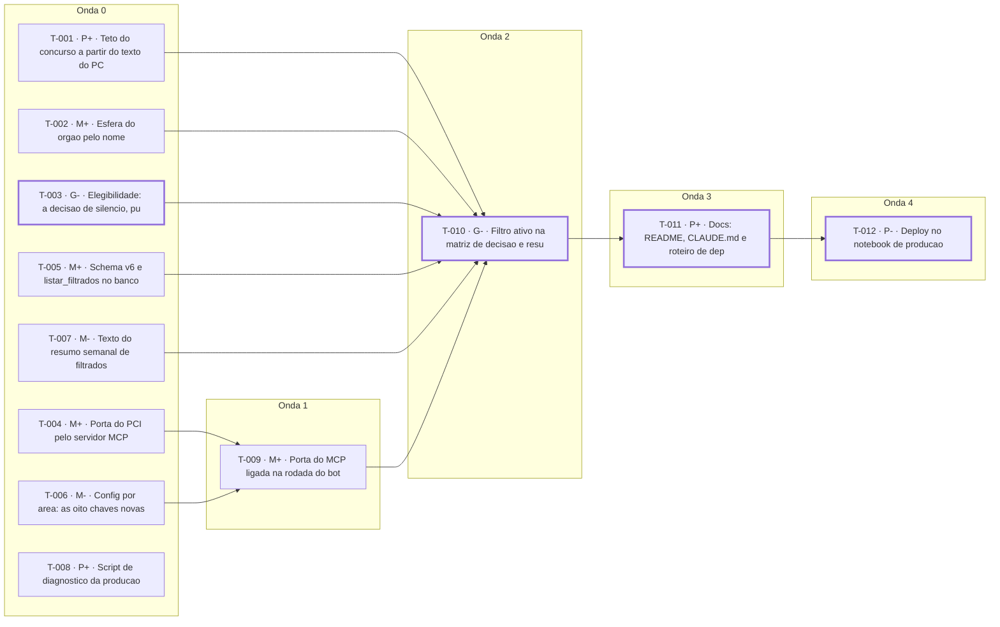

# Mapa de trabalho — monitor-concursos

> Gerado por `esteira.py mapa` em 2026-11-23 12:10. Não edite à mão: mude os tickets e gere de novo.

## Resumo

- 12 tickets: 4 backlog, 8 entregue
- Caminho crítico restante (peso 18): T-003 → T-010 → T-011 → T-012
- Ondas: 5; paralelismo máximo: 8 tickets numa onda
- Validação: 0 erro(s), 2 aviso(s)

## Ondas — o que vem antes e o que roda junto

Tudo numa onda pode rodar em paralelo; uma onda só começa quando as dependências dela estão integradas. ★ = caminho crítico (atraso aqui atrasa o fim).

### Onda 0 — começa já (8 em paralelo)

| Ticket | Nível | Executor | Repo | Status | Título |
|---|---|---|---|---|---|
| T-001 | P+ | glm-flash (high) | principal | entregue | Teto do concurso a partir do texto do PCI |
| T-002 | M+ | glm (high) | principal | entregue | Esfera do orgao pelo nome |
| T-003 ★ | G- | opus (high) | principal | entregue | Elegibilidade: a decisao de silencio, pura |
| T-004 | M+ | glm (high) | principal | entregue | Porta do PCI pelo servidor MCP |
| T-005 | M+ | glm (high) | principal | entregue | Schema v6 e listar_filtrados no banco |
| T-006 | M- | glm | principal | entregue | Config por area: as oito chaves novas |
| T-007 | M- | glm | principal | entregue | Texto do resumo semanal de filtrados |
| T-008 | P+ | glm-flash (high) | principal | entregue | Script de diagnostico da producao |

### Onda 1 — depois de T-004, T-006 (1 em paralelo)

| Ticket | Nível | Executor | Repo | Status | Título |
|---|---|---|---|---|---|
| T-009 | M+ | glm (high) | principal | backlog | Porta do MCP ligada na rodada do bot |

### Onda 2 — depois de T-001, T-002, T-003, T-005, T-007, T-009 (1 em paralelo)

| Ticket | Nível | Executor | Repo | Status | Título |
|---|---|---|---|---|---|
| T-010 ★ | G- | opus (high) | principal | backlog | Filtro ativo na matriz de decisao e resumo semanal |

### Onda 3 — depois de T-010 (1 em paralelo)

| Ticket | Nível | Executor | Repo | Status | Título |
|---|---|---|---|---|---|
| T-011 ★ | P+ | glm-flash (high) | principal | backlog | Docs: README, CLAUDE.md e roteiro de deploy |

### Onda 4 — depois de T-011 (1 em paralelo)

| Ticket | Nível | Executor | Repo | Status | Título |
|---|---|---|---|---|---|
| T-012 ★ | P- | glm-flash | principal | backlog | Deploy no notebook de producao |

## Conflitos de arquivo

Nenhum: tickets paralelos não tocam os mesmos arquivos.

## Recursos

- **notebook** (do dono): T-012 — só sai com a linha «Recurso notebook: feito» no ticket

## Gargalos (quem mais destrava)

- T-004: 1 ticket(s) dependem dele diretamente
- T-006: 1 ticket(s) dependem dele diretamente
- T-001: 1 ticket(s) dependem dele diretamente
- T-002: 1 ticket(s) dependem dele diretamente
- T-003: 1 ticket(s) dependem dele diretamente

## Grafo

