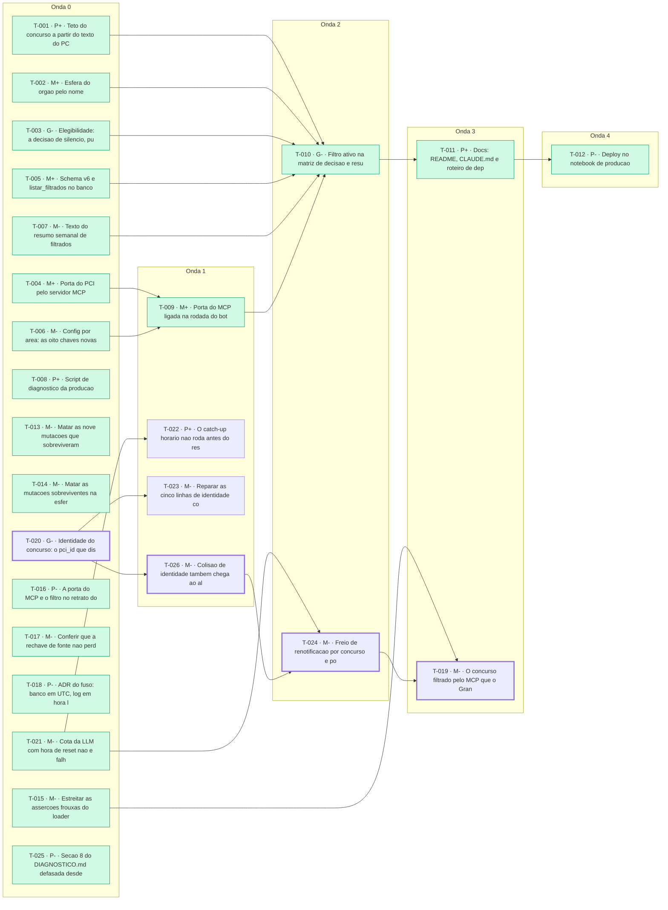

# Mapa de trabalho — monitor-concursos

> Gerado por `esteira.py mapa` em 2026-11-25 18:31. Não edite à mão: mude os tickets e gere de novo.

## Resumo

- 26 tickets: 5 backlog, 1 pronto, 20 integrado
- Caminho crítico restante (peso 17): T-020 → T-026 → T-024 → T-019
- Ondas: 5; paralelismo máximo: 17 tickets numa onda
- Validação: 0 erro(s), 2 aviso(s)

## Ondas — o que vem antes e o que roda junto

Tudo numa onda pode rodar em paralelo; uma onda só começa quando as dependências dela estão integradas. ★ = caminho crítico (atraso aqui atrasa o fim).

### Onda 0 — começa já (17 em paralelo)

| Ticket | Nível | Executor | Repo | Status | Título |
|---|---|---|---|---|---|
| T-001 | P+ | glm-flash (high) | principal | integrado | Teto do concurso a partir do texto do PCI |
| T-002 | M+ | glm (high) | principal | integrado | Esfera do orgao pelo nome |
| T-003 | G- | opus (high) | principal | integrado | Elegibilidade: a decisao de silencio, pura |
| T-004 | M+ | glm (high) | principal | integrado | Porta do PCI pelo servidor MCP |
| T-005 | M+ | glm (high) | principal | integrado | Schema v6 e listar_filtrados no banco |
| T-006 | M- | glm | principal | integrado | Config por area: as oito chaves novas |
| T-007 | M- | glm | principal | integrado | Texto do resumo semanal de filtrados |
| T-008 | P+ | glm-flash (high) | principal | integrado | Script de diagnostico da producao |
| T-013 | M- | glm | principal | integrado | Matar as nove mutacoes que sobreviveram na decisao de elegibilidade |
| T-014 | M- | glm | principal | integrado | Matar as mutacoes sobreviventes na esfera e na porta do MCP |
| T-015 | M- | glm | principal | integrado | Estreitar as assercoes frouxas do loader, do bot e do resumo |
| T-016 | P- | glm-flash | principal | integrado | A porta do MCP e o filtro no retrato do diagnostico |
| T-017 | M- | glm | principal | integrado | Conferir que a rechave de fonte nao perdeu concurso |
| T-018 | P- | glm-flash | principal | integrado | ADR do fuso: banco em UTC, log em hora local |
| T-020 ★ | G- | opus (high) | principal | pronto | Identidade do concurso: o pci_id que discorda vence o nome |
| T-021 | M- | glm | principal | integrado | Cota da LLM com hora de reset nao e falha generica |
| T-025 | P- | glm-flash | principal | integrado | Secao 8 do DIAGNOSTICO.md defasada desde a porta do MCP |

### Onda 1 — depois de T-004, T-006, T-020, T-021 (4 em paralelo)

| Ticket | Nível | Executor | Repo | Status | Título |
|---|---|---|---|---|---|
| T-009 | M+ | glm (high) | principal | integrado | Porta do MCP ligada na rodada do bot |
| T-022 | P+ | glm-flash (high) | principal | backlog | O catch-up horario nao roda antes do reset conhecido |
| T-023 | M- | glm | principal | backlog | Reparar as cinco linhas de identidade colidida |
| T-026 ★ | M- | glm | principal | backlog | Colisao de identidade tambem chega ao alerta do dia |

### Onda 2 — depois de T-001, T-002, T-003, T-005, T-007, T-009, T-021, T-026 (2 em paralelo)

| Ticket | Nível | Executor | Repo | Status | Título |
|---|---|---|---|---|---|
| T-010 | G- | opus (high) | principal | integrado | Filtro ativo na matriz de decisao e resumo semanal |
| T-024 ★ | M- | glm | principal | backlog | Freio de renotificacao por concurso e por dia |

### Onda 3 — depois de T-010, T-015, T-024 (2 em paralelo)

| Ticket | Nível | Executor | Repo | Status | Título |
|---|---|---|---|---|---|
| T-011 | P+ | glm-flash (high) | principal | integrado | Docs: README, CLAUDE.md e roteiro de deploy |
| T-019 ★ | M- | glm | principal | backlog | O concurso filtrado pelo MCP que o Gran acha depois |

### Onda 4 — depois de T-011 (1 em paralelo)

| Ticket | Nível | Executor | Repo | Status | Título |
|---|---|---|---|---|---|
| T-012 | P- | glm-flash | principal | integrado | Deploy no notebook de producao |

## Conflitos de arquivo

Nenhum: tickets paralelos não tocam os mesmos arquivos.

## Recursos

- **notebook** (do dono): T-023 — só sai com a linha «Recurso notebook: feito» no ticket

## Gargalos (quem mais destrava)

- T-021: 2 ticket(s) dependem dele diretamente
- T-020: 2 ticket(s) dependem dele diretamente
- T-004: 1 ticket(s) dependem dele diretamente
- T-006: 1 ticket(s) dependem dele diretamente
- T-001: 1 ticket(s) dependem dele diretamente

## Grafo

